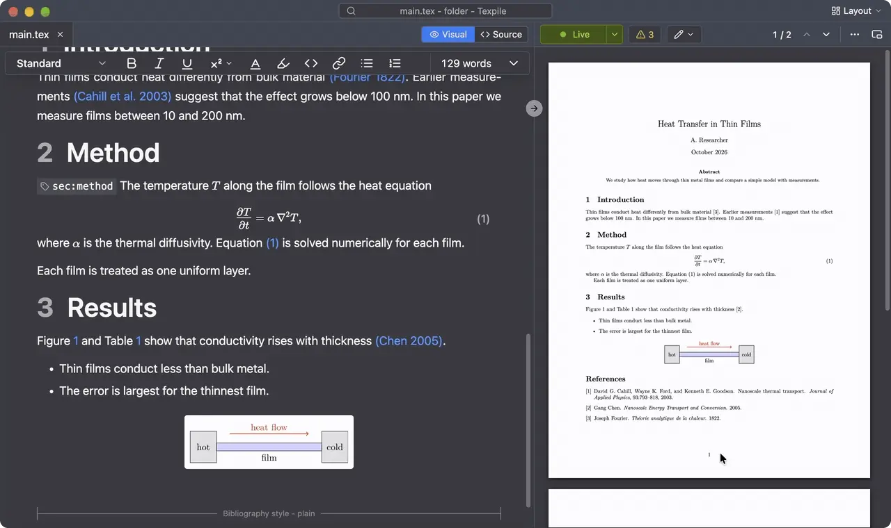
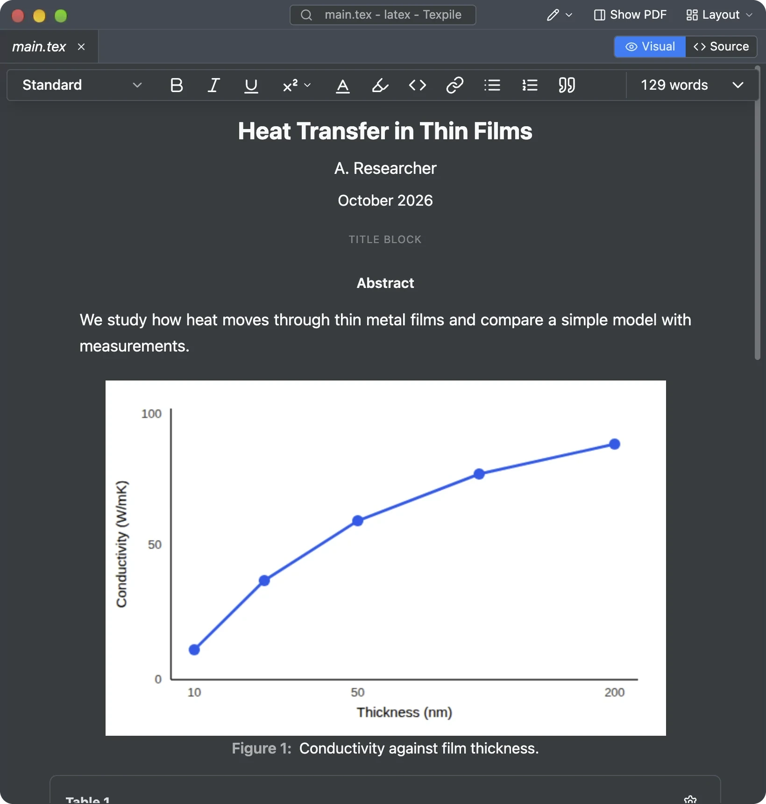
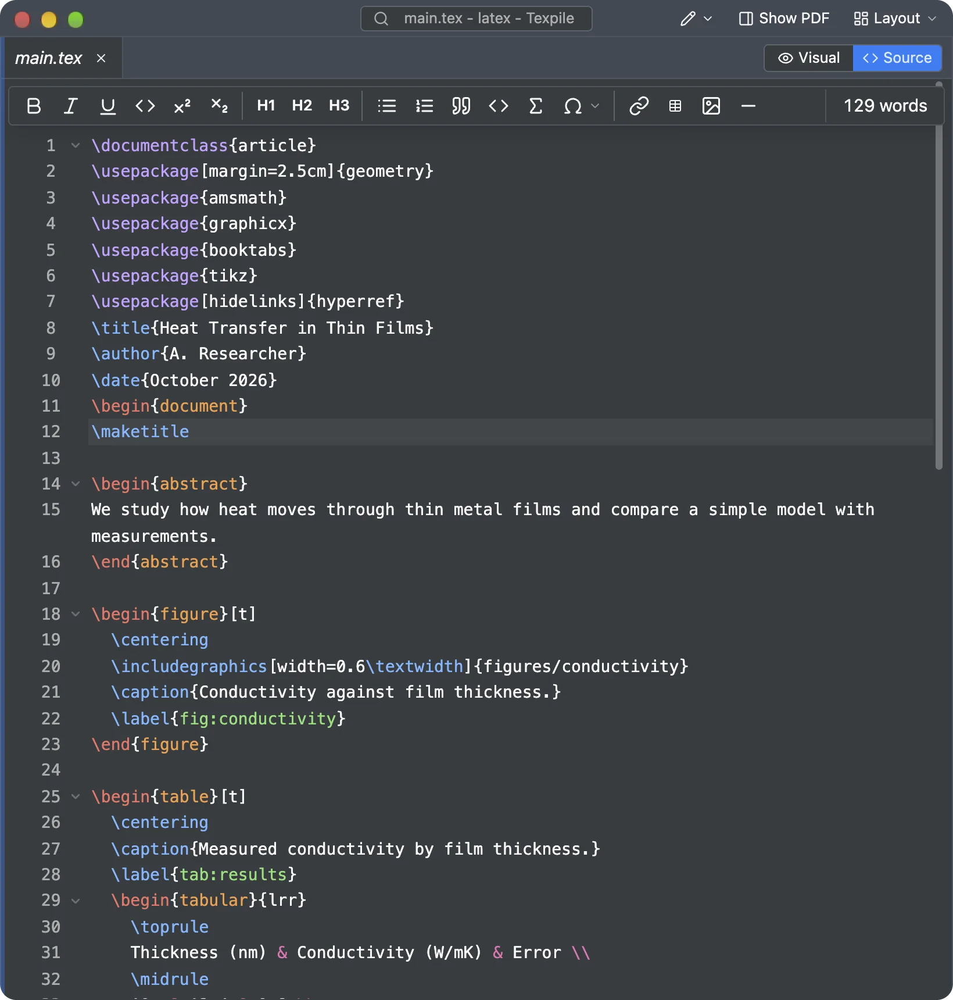
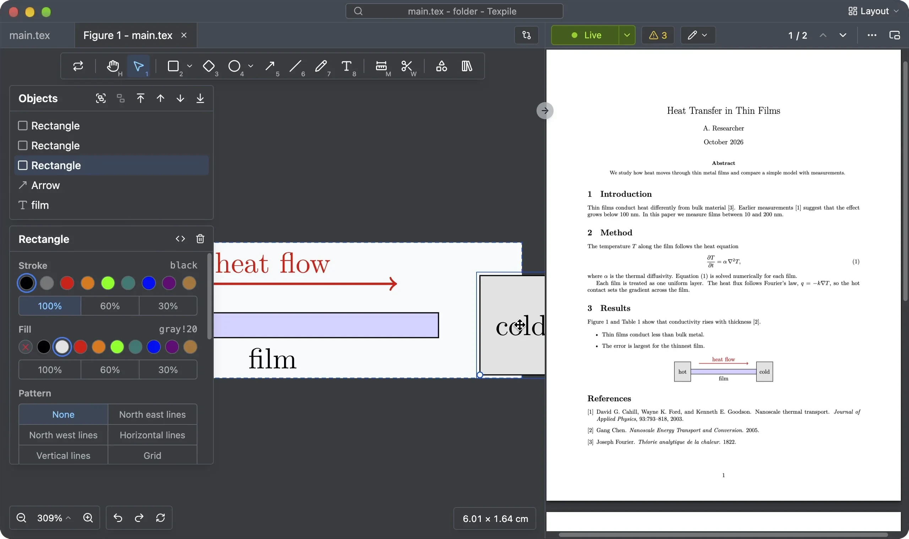

<picture>
  <source media="(prefers-color-scheme: dark)" srcset="branding/Logo-light.svg" />
  
</picture>

&nbsp;

A modern, desktop editor for LaTeX, Typst, and Markdown. For Windows, macOS, and Linux. Edit visually, or in source with advanced intellisense. 100% offline, no account.

---

## Why Texpile

### Live preview

- The PDF updates as you type. Texpile keeps your LuaLaTeX engine running, so most edits show in under 40 ms without a full recompile.
- Every window has its own preview.
- Texpile supports Typst's instant live preview.

### Visual editor

Texpile has the most complete visual editor coverage for LaTeX and Typst.

- Supports custom macros, multiline equations, commands, cell-merging tables and images.
- Supports Beamer and complicated documents.
- Uses Knuth-Plass line breaking.
- Opens .tex, .typ and .md files directly and stores them in those file formats.

<table>
  <tr>
    <th>Visual</th>
    <th>Source</th>
  </tr>
  <tr>
    <td></td>
    <td></td>
  </tr>
</table>

> You can see more examples here: https://texpile.com/#editing

### Figure editor

- A TikZ or CeTZ picture opens on a canvas. Texpile renders it with real TeX and Typst, so the editor is WYSIWYG.

### IntelliSense

- Texpile's LaTeX IntelliSense data covers ~95% of the LaTeX packages on CTAN (over 5,700 packages and 680 classes), and can suggest and detect certain errors instantly.
- It is project aware: it parses LaTeX aux files and covers refactoring, custom macro detection and more.
- For Typst, Texpile uses tinymist for IntelliSense.

### Shared sessions (real time collaboration)

Texpile supports real time collaboration (like VS Code Live Share), tuned specifically for LaTeX and Typst workflows, with end to end encryption. No account is needed. Start a session from File › Shared Session.

### Comments and suggestions

You can add visual comments and suggestions in Texpile, like in a word processor.

> [!NOTE]
> This list covers what sets Texpile apart from other LaTeX and Typst editors. See [texpile.com](https://texpile.com) for every feature, including AI integrations.

## Installation

Download the installer for your platform from [texpile.com/download](https://texpile.com/download).
Then install a typesetter:

- [LaTeX](https://texpile.com/docs/installation/latex)
- [Typst](https://texpile.com/docs/installation/typst)

You can either install those on your own or you can install them in Texpile with one click (see docs above).

## Privacy

Texpile works fully offline. Its only connections to Texpile are the update check and real time collaboration, which is end to end encrypted. Texpile physically cannot see your documents, even if we wanted to.

You can also self host your own real time collaboration relay.

## Community

Questions or feedback? Join the [Discord](https://discord.com/invite/7wanVzCBWf). Found a bug? [Open an issue](https://github.com/texpile/texpile/issues/new/choose).

For security issues, please email [support@texpile.com](mailto:support@texpile.com) directly.

## Contributing

Texpile would not be possible without our contributors and sponsors. See [CONTRIBUTING.md](CONTRIBUTING.md). To help translate the app, see [Translation.md](Translation.md).

> For people interested in submitting code:
>
> You may use generative AI in your work as long as you review the code and take responsibility for it. However, we ask you not to let AI handle your communication with us (unless needed for translation or grammar). We do not use AI to respond to your questions or PRs.

## Acknowledgements

Texpile builds on other open-source projects; see [ACKNOWLEDGEMENTS.md](ACKNOWLEDGEMENTS.md).

## License

[AGPL-3.0](LICENSE)

The Texpile name and logo are trademarks of the Texpile project and are not covered by the code
license; see [TRADEMARK.md](TRADEMARK.md).

We also ask that unofficial Texpile builds do not use our hosted relay at collab.texpile.com for real time collaboration.
