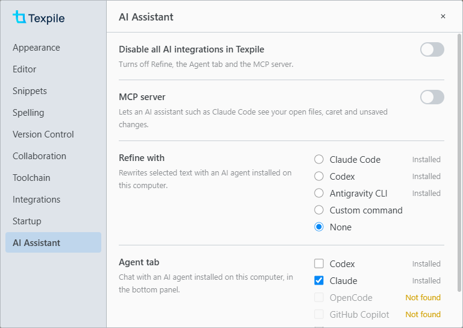

# AI Assistant

Texpile includes no AI. It works with an agent you install and sign in to yourself: chat with it in the [Agent tab](agent-panel.md), rewrite a selection with [Refine](refine.md), turn a picture into source with [Convert to LaTeX](convert-to-latex.md), or let it read your editor through the [MCP server](mcp.md). Desktop app only.

## Set up an agent

Install the agent and sign in outside Texpile, then pick it in `Preferences › AI Assistant`. The Agent tab has its own choice. **AI service** is the one Refine, [Proofread with AI](../spell-check.md#proofread-with-ai) and Convert to LaTeX use.

| Agent           | Agent tab | AI service | Sign in from a terminal |
| --------------- | --------- | ---------- | ----------------------- |
| Codex           | Yes       | Yes        | `codex login`           |
| Claude Code     | Yes       | Yes        | Run `claude`            |
| OpenCode        | Yes       | No         | `opencode auth login`   |
| GitHub Copilot  | Yes       | No         | Run `copilot`           |
| Gemini          | Yes       | No         | Run `gemini`            |
| Antigravity CLI | No        | Yes        | Its own sign-in (`agy`) |

You can also enter your own command. For the Agent tab it must speak the Agent Client Protocol, such as `opencode acp`. For the AI service it reads a request and prints the answer, such as `ollama run llama3.1`.

If an agent shows **Not found**, add its folder in `Preferences › Programs & Compiler › Other folders`, then reopen Preferences.

## Custom service

**Custom service**, under **Advanced** in the AI service list, sends requests straight to an address that speaks the OpenAI chat API. It suits a model in Ollama or LM Studio on your computer, a university gateway, OpenRouter, OpenAI or Anthropic. Texpile keeps the key in the system password store.

| Field           | Description                                                                                                                         |
| --------------- | ----------------------------------------------------------------------------------------------------------------------------------- |
| Service address | The base URL, ending in `/v1`: `http://localhost:11434/v1` for Ollama, `https://api.openai.com/v1`, `https://api.anthropic.com/v1`. |
| API key         | Sent as a bearer token. Ollama and LM Studio need none.                                                                             |
| Model           | The model name the service uses, such as `gemma3:4b` or `claude-haiku-5-5`.                                                         |

Convert to LaTeX needs a model that reads pictures.

## Turn off AI

**Disable all AI integrations in Texpile**, at the top of `Preferences › AI Assistant`, turns off Refine, the Agent tab and the MCP server. Until you pick an agent, the Agent tab also offers it as a **Disable All AI** button. Turn the switch off to bring back Refine and the Agent tab with your earlier choices. The MCP server stays off until you turn it on again.

What each feature sends is in [Privacy](../reference/privacy.md).
