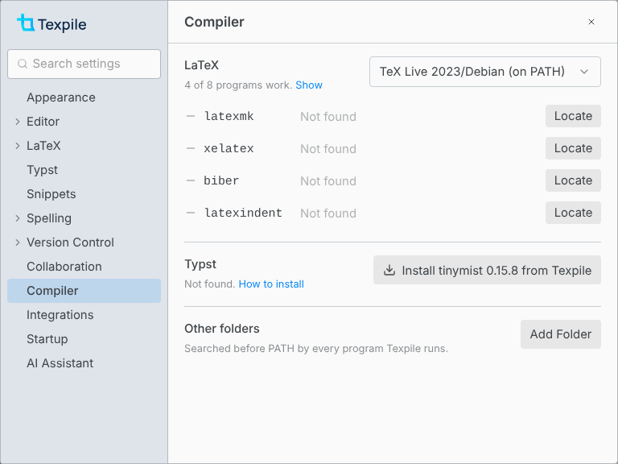
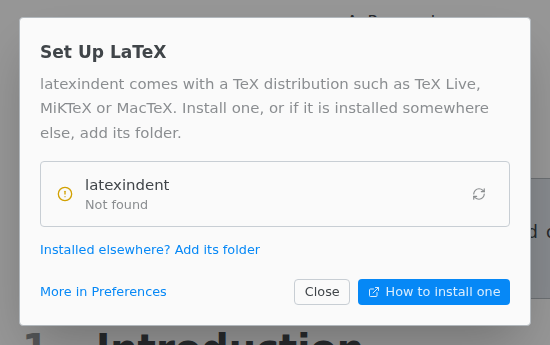
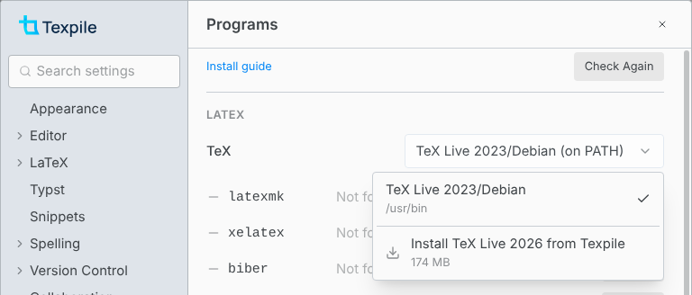

# Programs & Compiler

**File › Preferences… › Programs & Compiler** has a row for LaTeX, a row for Typst and a row for other folders.

Each language row has a picker for the install Texpile uses. The line under the language's name says how its programs are doing, for example "7 of 8 programs work." **Show** lists the ones that work with their versions. A program that is missing or does not run gets a line of its own under the row. When Texpile finds none of a language's programs, the row says **Not found.** with a **How to install** link to the install guide. Texpile checks the programs again each time the page opens.

Git is in **Preferences › Version Control**, in the **Git Program** row. When git is missing, that row links to [Install Git](../installation/git.md) and has **Locate**.

Texpile needs only the programs your commands call. The default compile command needs latexmk and lualatex. Live preview needs lualatex, **Format Document** needs latexindent, and jumping between the text and the PDF needs synctex.

Texpile reads your PATH once, when it starts: restart it after you change PATH. Folders you add under **Other folders** apply at once.

## The Set Up dialog

**Set Up LaTeX** or **Set Up Typst** opens when a compile, a jump, Format Document or the live preview needs a program that is missing.

- **Installed elsewhere? Add its folder** adds the folder to **Other folders**.
- **Install TeX Live** installs TeX Live when Texpile finds no TeX. See [Install TeX Live](#install-tex-live).
- **How to install one** opens the [TeX install guide](../installation/latex/README.md).
- If TeX Live or MiKTeX is installed but lacks the program, the dialog says so. Add the program with that distribution's package manager.

## Pick an install and add folders

The **LaTeX** picker lists every TeX Live and MiKTeX Texpile finds. The one in use has a check mark. Pick another to put its folder first. **(on PATH)** marks the one your PATH reaches. For a TeX Texpile does not find, choose **Locate TeX…** at the end of the menu and pick lualatex in it. The **Typst** picker has **Locate tinymist…** in the same place.

Add a program missing from your TeX with that distribution's package manager, such as tlmgr or MiKTeX Console.

Texpile searches **Other folders** before PATH, for every program it runs, including your compile command and git. **Add Folder** adds one or more. On Linux it adds one at a time. Each folder shows what Texpile found in it.

## Install TeX Live

Open the **LaTeX** picker and click **Install TeX Live 2026 from Texpile**. With no TeX found, the row has **Locate** and **Install TeX Live** in place of the picker. The **Set Up LaTeX** dialog offers it too. Texpile downloads TeX Live 2026 from dl.texpile.com and checks it against a checksum. The download is 174 MB on Linux (180 MB on Arm), 230 MB on macOS and 287 MB on Windows. The install needs about 1 GB of free space. It holds lualatex, pdflatex, xelatex, latexmk, biber and the packages most papers load.

Texpile has a build for Windows, macOS, and Linux with glibc on x64 and Arm. On other systems, such as Alpine Linux, [install a TeX distribution yourself](../installation/latex/README.md#install-a-tex-distribution-yourself).

The install goes into Texpile's own data folder, apart from any TeX you already have.

After the install, the picker uses **TeX Live 2026 (installed by Texpile)**. Pick another install to switch back. To delete it, click **Remove** next to "Texpile installed TeX Live 2026."

When a document loads a package this TeX Live lacks, the live preview and **Compile** install it with tlmgr, TeX Live's own package manager, and compile again. Each package needs the internet once.

## Install tinymist for Typst

Open the **Typst** picker and click the option that starts with **Install tinymist**. With no tinymist found, the row has **Locate** and **Install tinymist** in place of the picker. The **Set Up Typst** dialog and the "tinymist is not installed." bar above a `.typ` file offer it too.

After the install, the picker uses the entry that ends in **(installed by Texpile)**. Pick another install to switch back. **Remove** deletes the tinymist Texpile installed.

If that tinymist fails to run on your computer, [install tinymist yourself](../installation/typst/README.md).
