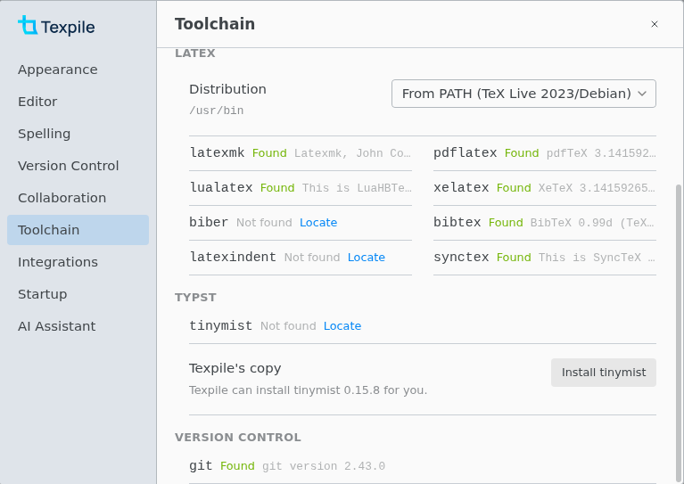

# Toolchain

**File › Preferences… › Toolchain** shows which programs Texpile found and where it looks for them.

Texpile needs only the programs your commands call. The default compile command needs latexmk and lualatex. Live preview needs lualatex, **Format Document** needs latexindent, and jumping between the text and the PDF needs synctex.

Texpile reads your PATH once, when it starts: restart it after you change PATH. Folders you add here apply at once.

## The Set Up dialog

**Set Up LaTeX** or **Set Up Typst** opens when a compile, a jump, Format Document or the live preview needs a program that is missing.

- **Installed elsewhere? Add its folder** adds the folder to **Folders**.
- **Install TeX Live** installs TeX Live when Texpile finds no TeX. See [Install TeX Live](#install-tex-live).
- **How to install one** opens the [TeX install guide](../installation/latex/README.md).
- If TeX Live or MiKTeX is installed but lacks the program, the dialog says so. Add the program with that distribution's package manager.

## Folders and distribution

Texpile searches **Folders** before PATH, for every program it runs, including your compile command. **Locate** on a **Not found** row adds the program's folder.

With more than one TeX Live or MiKTeX installed, pick one under **Distribution** to put its folder first. **From PATH** uses your PATH.

## Install TeX Live

**Install TeX Live** is in the LaTeX section and in the **Set Up LaTeX** dialog when Texpile finds no TeX. Texpile downloads TeX Live 2026 from dl.texpile.com and checks it against a checksum. The download is 175 MB on Linux, 230 MB on macOS and 282 MB on Windows. It holds lualatex, pdflatex, xelatex, latexmk, biber and the packages most papers load.

A TeX on PATH or in **Folders** comes first. To use the TeX Live Texpile installed, pick **TeX Live 2026 (installed by Texpile)** under **Distribution**. **Remove** deletes it.

When a document loads a package this TeX Live lacks, the live preview and **Compile** install it with tlmgr, TeX Live's own package manager, and compile again. Each package needs the internet once.

## Install tinymist for Typst

**Install tinymist** is in the Typst section, the **Set Up Typst** dialog, and the "tinymist is not installed." bar above a `.typ` file.

A tinymist on PATH or in **Folders** comes first. To use the tinymist Texpile installed, pick the entry that ends in **(installed by Texpile)** under **Distribution**.

If that tinymist fails to run on your computer, [install tinymist yourself](../installation/typst/README.md).
