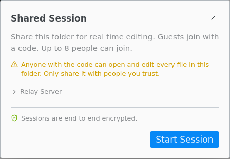
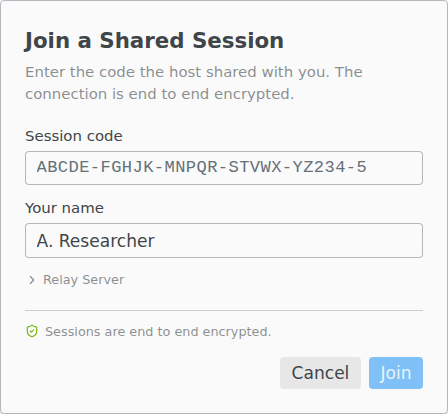

# Real-time collaboration

Edit a folder with other people at the same time. Guests join with only a code, in Texpile or in a browser.

> [!REQUIRES] an internet connection

## Host a session

Open a folder in the desktop app, choose `File › Shared Session`, click **Start Session**, and send guests the link or the code. Only the desktop app hosts, and only with a whole folder open.

- Click the guest avatars in the title bar to reopen the dialog. **End Session** stops the code for everyone. Closing the folder or window, or reloading, also ends it.
- Change the **Relay Server** address only when someone gives you another one. Guests then enter the same address and join with the code instead of the link.
- Only you compile, with the programs on your computer. Guests see the PDF and the problems.
- During a session, shell escape and LaTeX live preview are off. Guests see the Typst preview, which needs Typst on your computer only.
- Guest edits, new files, renames and deletes are written into your folder. Deleted files go to your trash.

## Join a session

On the start screen, click **Join Session** and enter the code (or the whole link) and your name. A link opened in a browser offers **Open in the Texpile App**, or **Join Here** to join in the browser with nothing to install.

Session links open the installed version of Texpile. In the portable version, enter the code on its start screen.

If your connection drops, Texpile keeps trying and merges your edits, including offline edits, when it is back. **Collaborating** › **Leave** in the title bar keeps the session running for the others.

## What is shared

Guests see the compiled PDF, the compile problems, the comments, and every file up to 100 MB except those whose names start with a dot, such as `.git` and `.texpile`. Text files over 2 MB are view only. A session holds up to 8 guests, all on Texpile 1.2.0 or newer.

## What guests cannot do

Only the host compiles and saves. A guest asks for a compile with **Request Compile** at the top of the PDF. Source Control, Format Document, search in files, the terminal, the Agent tab, Refine, Zotero, Cite by title or DOI, and Version History are for the host only.

## Anyone with the code can edit

- Anyone with the code or the link can open and edit every shared file. Joining takes no account, password or approval, and every guest has edit access.
- To remove someone, end the session for everyone and start a new one, which gets a new code.
- Guests name themselves, and comments carry whatever name a guest typed.
- Sessions are end to end encrypted. Texpile's server sees that a session exists, how many guests are in it, when messages are sent and how big they are, and network addresses. It cannot read files, names, cursors or comments.
