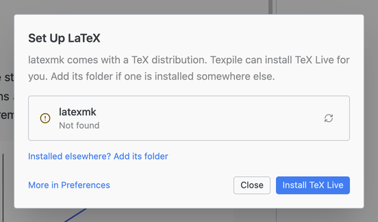

# LaTeX

## From Texpile (recommended)

1. Open any folder with a .tex file.
2. Open the .tex file and click **Compile**.
3. Click **Install TeX Live** in the **Set Up LaTeX** dialog.

You can also find it in **File › Preferences… › Programs & Compiler**. Click **Install TeX Live** in the **LaTeX** row.

For the download size and where the install goes, see [Install TeX Live](../../build-and-preview/toolchain.md#install-tex-live).

> This is not a full TeX distribution. Texpile will install a ~300 MB distribution and leave the rest of the packages to be installed on demand (requires an internet connection).

## Install a TeX distribution yourself

On [Windows](windows.md), [macOS](macos.md), or [Linux](linux.md).
