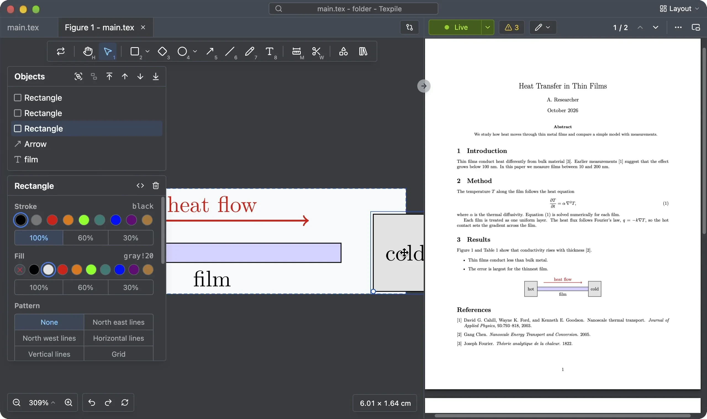

# TikZ editor

A `tikzpicture` opens in the TikZ editor. Draw on a canvas and Texpile writes the TikZ into your `.tex` file.

> Tip: to see the TikZ code, use the split editor, with the figure editor in one pane and the source editor in the other. Click the **Layout** button at the top right corner.

## Shortcuts

Draw with the tools. Each has a key:

| Tool      | Key | Tool      | Key |
| --------- | --- | --------- | --- |
| Hand      | H   | Line      | L   |
| Select    | V   | Pen       | P   |
| Rectangle | R   | Text      | T   |
| Diamond   | D   | Dimension | M   |
| Ellipse   | O   | Trim      | W   |
| Arrow     | A   |           |     |

## Undo and redo

If your figure is not a standalone .tikz file, it shares the same undo-redo history as the original .tex file.

## LuaLaTeX

The figure editor uses LuaTeX and the same technology as Texpile's Live mode.

If LuaLaTeX is missing, see [Install a TeX distribution](../installation/latex/README.md).
