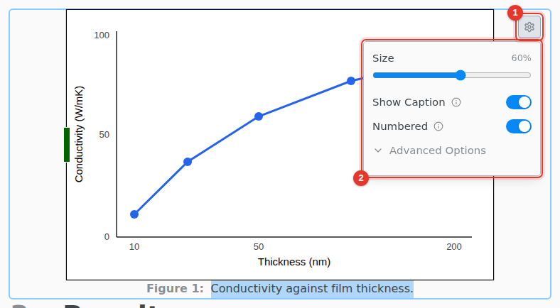

# Figures and images

Drag an image onto the editor, paste one, or use Insert › Image…. PNG, JPEG, GIF and WebP work. A pasted picture is saved in an `images` folder next to the file.



1. Select the image and click its settings icon.
2. Set the **Size**, and turn on **Show Caption** and **Numbered**.

Type @ anywhere to reference a numbered figure. Drag the handles of a selected image to resize it.

A PDF figure shows its first page. To show an image from a web address, save it in the project.

## Crop and turn

Hover an image and click the crop button beside its settings button. The whole image shows with the area outside the crop box dimmed. Drag the eight handles or move the box.

The bar under the image has **Turn left**, **Turn right**, **Reset**, **Cancel** and **Done**. Enter is **Done** and Escape is **Cancel**.

**Done** writes `trim`, `clip` and `angle` into the options of the image's `\includegraphics`:

```latex
\includegraphics[angle=90, width=0.8\linewidth, trim=66 6 11 33, clip]{loss.png}
```

The image file stays as it is. The same file can appear twice with two different crops. Opening crop again shows the saved box.

To edit the image file itself, see [Images](../projects/images.md).
