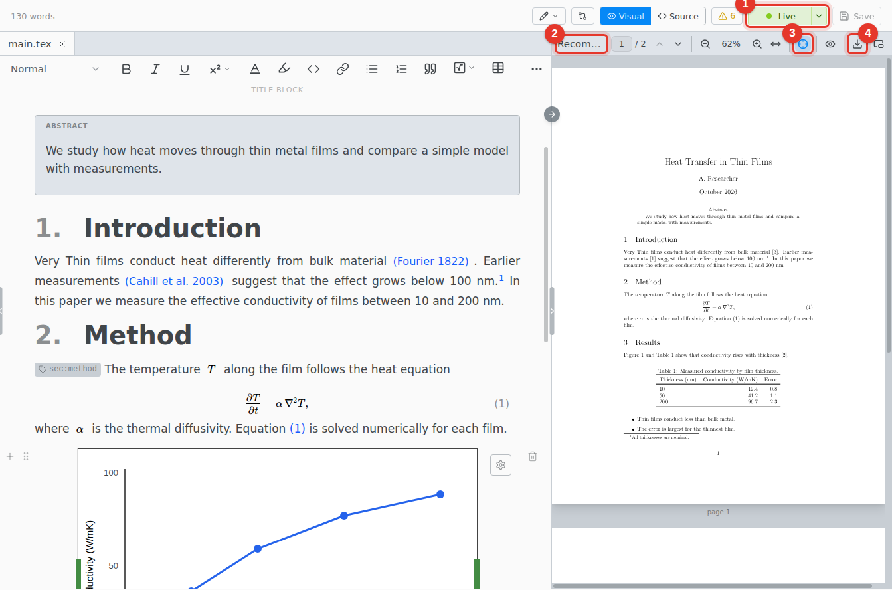
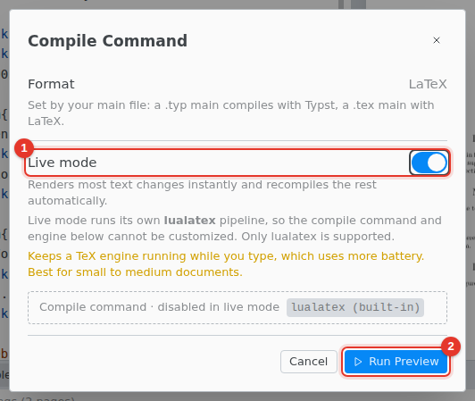

# Live preview

The PDF updates as you type. Live preview keeps your own lualatex running and typesets the part of the document you changed.

> If you are curious how live preview works, here is a quick explanation: Texpile’s live preview is inspired by TeXpresso (but uses LuaTeX instead). Instead of using Unix’s fork(), which does not work on Windows, Texpile takes a snapshot of many variables, just enough to fully define the TeX engine at that time. When you edit a document, Texpile reverts to the closest snapshot (I internally call this “teleport”) and renders the next edit.

The basic controls should be self-explanatory:

1. **Live.** Click to pause. **Paused** resumes.
2. **Status.** What the preview did last, such as an update or a full compile.
3. **Follow edits.** Scrolls the PDF to where you type.
4. **Save PDF.** Compiles the whole document and saves the PDF. It is in the "…" menu.

> What live mode renders is exactly what LuaTeX will render. If you see a difference, open an issue on GitHub.

Pinch on a trackpad, or scroll with Ctrl held (Cmd on macOS), to zoom around the pointer. Double-click the preview to jump to that place in the editor.

## Turn it on

Open the menu next to Compile and choose **Configure Compile Command…**.

1. Turn on **Live mode**.
2. Click **Run Preview**.

Live mode is saved for the folder. While it is on, the Compile button reads **Preview** and opens the live preview. Close the PDF pane to stop the preview.

Each window runs its own live preview.

## What it needs

- **lualatex**, from TeX Live, MacTeX or MiKTeX. With none found, the preview says "lualatex is not installed." and offers the [Compiler](../build-and-preview/toolchain.md) page, where Texpile can install TeX Live.
- **LaTeX 2021-06 or newer.** With an older one the preview says "Live mode needs LaTeX 2021-06 or newer." Update your TeX distribution. This is a theoretical floor. It is highly recommended that you use 2025 or newer.

## Speed

The first preview compiles the whole document, so it takes the longest. A line under the toolbar moves while a compile runs, and the status says "Compiling project…".

After that, most text edits show at once. Texpile recompiles on its own for the edits that need it.

## Limits

- **lualatex only.**
- **No shell escape.**
- **Not while you host a shared session.**
- **Battery life.** Especially on Windows. LaTeX compiling depends on single-core speed.
- **Long documents.** Live mode suits small to medium documents.
