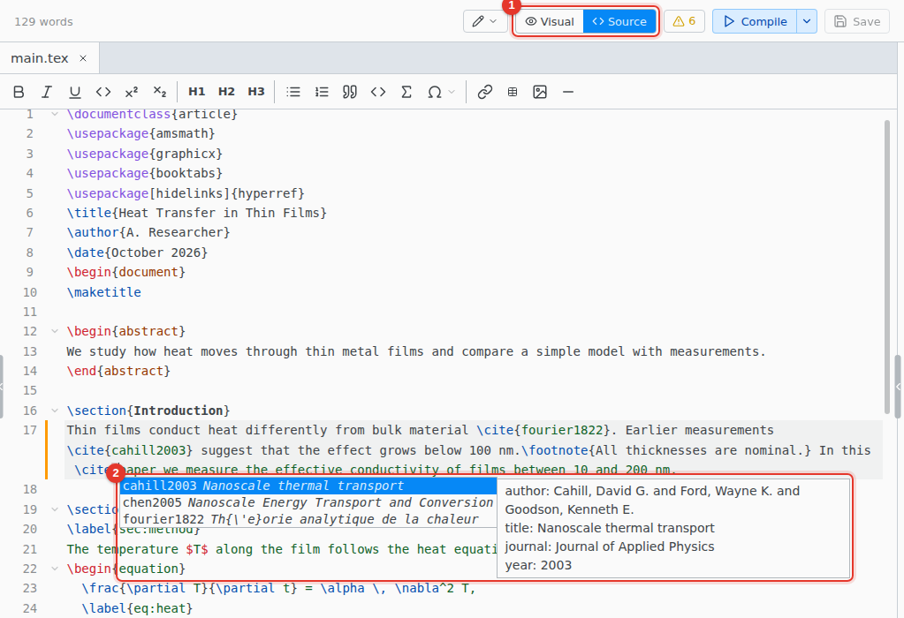
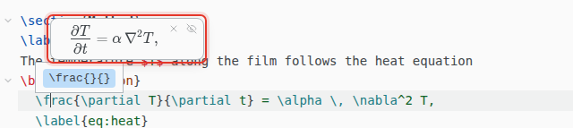

# Source editor

Edit the LaTeX directly. Commands, labels, citation keys and file names complete from your whole project.

1. **Source.** Switch to the source editor.
2. **Completion.** Opens as you type. Ctrl Space opens it any time.

Completion covers commands (your own `\newcommand` macros too), environments, packages, labels, citation keys and file names. In `\cite{`, search by key, title or author. Type `@` and a letter for a symbol: `@a` offers `\alpha`.

Commands and environments come from the class, packages and libraries your project loads. Common packages outside your preamble offer theirs too, last in the list with the package name beside them. Choosing one offers to add its `\usepackage`.

A file with no `\documentclass` or `\usepackage` in a folder with no main file has no packages Texpile can read. Completion then offers the commands of common packages under the heading "No main file found. Some IntelliSense features are degraded." and offers no `\usepackage`.

## Go to definition and hover

F12, or Ctrl Click, on a label, a citation key, one of your own commands, or a file in `\input` opens where it is defined.

Hovering shows the citation's entry, the image of an `\includegraphics`, or the typeset equation a `\ref` points to.

## Rename

F2 on a label, a citation key or a glossary entry asks for a new name. Texpile renames its definition and every use in the document. A citation key also changes in every document that shares its `.bib` file.

Comments and commented-out code follow the rename. Text in `verbatim`, `lstlisting` or `minted` and in `\verb` or `\lstinline` keeps its words. In a shared session only the host renames a name that other files use.

## Math preview

The equation under the cursor shows typeset above it. Esc hides it.

Inside math, Ctrl Space opens the symbol search the visual editor's equations have, with your math snippets in it. With Emacs keys, Ctrl Space sets the mark instead.

## Symbols

Insert › Symbol… finds a symbol by command (`subsetneq`), by meaning (`not equal`) or by package. It shows the `\usepackage` line the symbol needs and offers to add it.

A meaning can also be what a letter stands for in a field: `stress` finds σ and τ, and `learning rate` finds η. A word with a small typo, such as `lamda`, still finds its symbol. The math search inside an equation finds symbols the same way.

## Format Document

Format › Format Document tidies the indentation. Only spacing changes.

## Keyboard shortcuts

On macOS, use Cmd for Ctrl. For Vim or Emacs keys, see File › Preferences… › Editor › Keybindings.

| Shortcut      | Action                                          |
| ------------- | ----------------------------------------------- |
| Ctrl Space    | Show suggestions, or the symbol search in math  |
| F12           | Go to definition                                |
| F2            | Rename a label, citation key or glossary entry  |
| Ctrl D        | Select the next match                           |
| Ctrl Alt Up   | Add a cursor above                              |
| Ctrl Alt Down | Add a cursor below                              |
| Ctrl B        | `\textbf{}`                                     |
| Ctrl I        | `\textit{}`                                     |
| Ctrl M        | `\( \)`                                         |
| Ctrl Shift M  | `\[ \]`                                         |
| Ctrl Alt 1    | `\section{}`, with 2 and 3 for the levels below |
