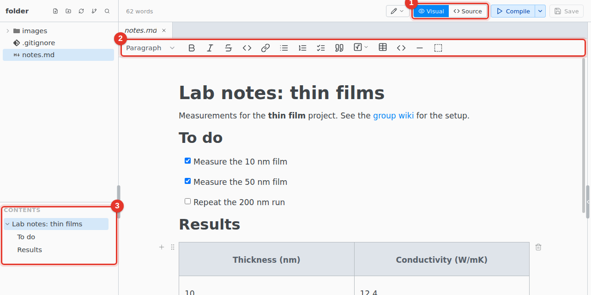

# Markdown

Texpile edits `.md` files visually or as source, and saves them as plain Markdown. The visual editor is the preview, in place of a PDF.

1. **Visual / Source.** Switch editors at any time.
2. **Toolbar.** Adds strikethrough and task lists, and leaves out underline, color, superscript and subscript, which Markdown lacks.
3. **Contents.** The headings of the file. Click one to go there.

Start a file with File › New › Markdown File.

## Not in Markdown

Citations, cross-references, and equation, figure and table numbers are LaTeX and Typst features. Comments and suggestions work in Markdown too.
