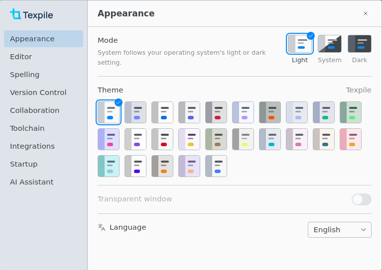

# Preferences

Preferences holds the settings for the whole app. Open it with Ctrl , (Cmd , on macOS) or File › Preferences… (Texpile › Preferences… on macOS).

| Setting                                                  | Note                                                                                                                                                                                            |
| -------------------------------------------------------- | ----------------------------------------------------------------------------------------------------------------------------------------------------------------------------------------------- |
| Appearance › Language                                    | Changes the interface only. Spell check follows each document's own language.                                                                                                                   |
| Editor › Keybindings                                     | Vim and Emacs work in the source editor only.                                                                                                                                                   |
| Keyboard Shortcuts                                       | Changes the keys of any command. See [Keyboard shortcuts](shortcuts.md#change-a-shortcut).                                                                                                      |
| Editor › Justify text, Hyphenate words                   | Apply to the visual editor only. The file and the compiled document stay as they are.                                                                                                           |
| Editor › Auto-fraction, Tab out of brackets, Matrix keys | Source editor math only. See [Math typing helpers](typing.md#math-typing-helpers).                                                                                                              |
| Editor › Fold when a file opens                          | Source editor only. Each stop to the right folds more: figures and tables, then equations, then all environments, then everything. A file you folded or unfolded yourself opens as you left it. |
| Spelling › Check spelling and grammar                    | Off by default.                                                                                                                                                                                 |
| Spelling › This folder › Language                        | The same choice as Edit › Spelling › Folder Language. Needs an open folder.                                                                                                                     |
| Spelling › Default language                              | For documents that name no language, in folders set to Automatic. English by default.                                                                                                           |
| Spelling › Custom Dictionary                             | One list per language. Separate several words with spaces, commas, or semicolons.                                                                                                               |
| Spelling › Grammar rules                                 | All off by default. Shown while English is the default language or the open folder is checked in English.                                                                                       |
| Version Control › Git Program                            | The git Texpile runs. When git is missing, **Locate** adds its folder to Compiler › Other folders.                                                                                              |
| Version Control › Autofetch                              | Fetches from the default remote every 3 minutes.                                                                                                                                                |
| Version Control › Git Identity                           | Read-only. Change it with `git config` in a terminal.                                                                                                                                           |
| Version Control › Keep version history                   | Keeps a copy of each save for 30 days.                                                                                                                                                          |
| Collaboration › Display name                             | Shown in shared sessions and on your comments. Left empty, you show as Host or Guest.                                                                                                           |
| Compiler › Other folders                                 | Texpile looks here first for every program it runs, including your compile command. See [Compiler](build-and-preview/toolchain.md).                                                             |
| Compiler › LaTeX and Typst                               | Which TeX distribution and which tinymist Texpile uses. Each picker also installs Texpile's own.                                                                                                |
| Integrations › Find and cite papers online               | Looks papers up through Crossref, DataCite, doi.org, Open Library, and PubMed.                                                                                                                  |
| AI Assistant › Disable all AI integrations in Texpile    | Turns off Refine, the Agent tab and the MCP server. Your choices below it stay as they were.                                                                                                    |
| AI Assistant › MCP server                                | Lets an AI assistant such as Claude Code see your open files. See [MCP server](ai-assistant/mcp.md).                                                                                            |
| AI Assistant › Refine with                               | Only agents Texpile finds can be picked. To add another, add its folder under Compiler › Other folders.                                                                                         |
| AI Assistant › Agent tab                                 | Untick every agent to remove the tab.                                                                                                                                                           |

## Not in Preferences

- The compile command, output paths, and live mode are saved per folder: **Configure Compile Command…** in the menu next to Compile.
- Interface zoom: Layout › Zoom.
- Which panels show, and how the editor and the PDF are split: Layout in the title bar.
- Dark PDF pages: **Invert colors** in the PDF bar's "…" menu, remembered separately for light and dark mode.
