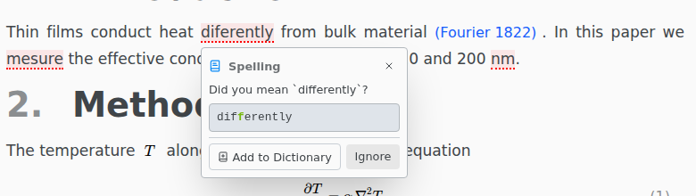

# Spell check

Texpile underlines spelling problems in English, German, French, Spanish, Italian, Dutch, Portuguese (Brazil and Portugal) and Polish, and grammar problems in English. Math, code, commands and `.bib` files are skipped. Turn it on in File › Preferences… › Spelling & Grammar.

Click an underlined word for suggestions. F8 and Shift F8 jump to the next and previous problem.

For a grammar problem, the box swaps Add to Dictionary for **Turn Off Rule**, which stops that rule in every file. Preferences › Spelling & Grammar turns it back on, and holds the English variant and your dictionary.

## Languages

A document is checked in the language it names:

| Format              | Example                        |
| ------------------- | ------------------------------ |
| LaTeX (babel)       | `\usepackage[ngerman]{babel}`  |
| LaTeX (polyglossia) | `\setmainlanguage{french}`     |
| Typst               | `#set text(lang: "es")`        |
| Markdown            | `lang: it` in the front matter |

A chapter brought in with `\input` or `#include` follows its main file. Any other document is checked in Preferences › Spelling & Grammar › Default language, which starts as English. Only the languages above have dictionaries, so a document in another language, such as Russian, is skipped.

Edit › Spelling › Folder Language, or Preferences › Spelling & Grammar › This folder, sets one language for every file in the folder, over what the files name. It is saved in the folder's `.texpile/config.json`, so co-authors get it too. Automatic goes back to what each file names, and says where its language comes from: the document, or the default.

Each language has its own dictionary: Add to Dictionary on a German word adds it to the German one. Preferences › Spelling & Grammar › Custom Dictionary shows one language at a time.

## Proofread with AI

Proofread with AI checks the spell check's findings with an AI model. It drops false alarms such as a field term, puts a better fix first, and adds grammar and wording problems the spell check misses. Its own findings carry an **AI** badge in the suggestion box. It works in every language above.

It starts once you pick an agent in Preferences › AI agent, and uses the Proofread model picked there. Turn it off in Preferences › Spelling & Grammar › Proofread with AI. See [Set up an agent](ai-assistant/README.md#set-up-an-agent).

A few seconds after you stop typing, the paragraphs on screen go to the service with equations left out. Wording suggestions can be turned off. Add terms to the dictionary, on by default, lets the model add names, abbreviations and field terms to your dictionary, and a message lists each word it added with an Undo button.
