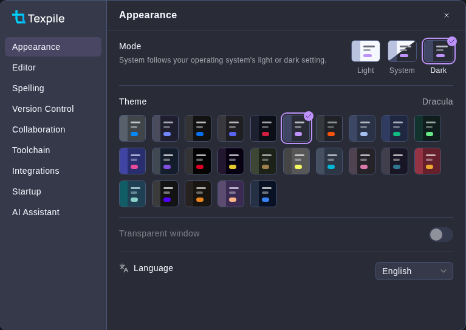

# Themes

Preferences › Appearance has 25 color themes, each in light and dark.



**Transparent window** blurs the desktop behind Texpile. Windows 11 and macOS only.

**Text font** sets the font of the visual editor text, headings included. The picker lists the fonts installed on the computer and shows each in its own face. Default follows the theme. A font chosen here overrides the font of a theme. The interface and math keep their fonts.

## Custom themes

A custom theme is a CSS file in the themes folder. Preferences › Appearance › Open Themes Folder opens it. Each `.css` file in the folder shows as a tile under Custom themes, named after the file. For example, `night-owl.css` shows as Night Owl.

A custom theme can hold any CSS. One theme covers both light and dark mode, and rules under `[data-mode='dark']` apply in dark mode only.

Fonts and images go in a folder named after the theme. Your CSS should load them with a relative `url()`.

```
themes/
  night-owl.css
  night-owl/
    paper.jpg
    stix.woff2
```

```css
:root {
	--color-primary-500: #82aaff;
	--syntax-keyword: #c792ea;
}

[data-mode='dark'] {
	--color-surface-950: #011627;
}

body {
	background-image: url(night-owl/paper.jpg);
}
```

A theme loads files from the themes folder only. Texpile does not load anything from the web.

To install a theme, copy its `.css` file and its folder into the themes folder. To share one, send both.

### Variables

It is strongly recommended that you use only Texpile variables in your CSS:

```css
:root {
	--color-primary-500: #82aaff;
	--color-surface-950: #011627;
}
```

| Variables                                                                      | What they color                                                                     |
| ------------------------------------------------------------------------------ | ----------------------------------------------------------------------------------- |
| `--color-primary-50` to `--color-primary-950`                                  | Buttons, links and other accents. 500 is the main shade.                            |
| `--color-secondary-*`, `--color-tertiary-*`                                    | The second and third accents.                                                       |
| `--color-success-*`, `--color-warning-*`, `--color-error-*`                    | Messages, problems and changes.                                                     |
| `--color-surface-50` to `--color-surface-950`                                  | The ground, panels and text. Light mode uses the low shades and dark mode the high. |
| `--syntax-comment`, `--syntax-keyword`, `--syntax-command`, `--syntax-string`… | Source editor highlighting.                                                         |
| `--find-match-bg`, `--find-match-active-bg`                                    | Find matches.                                                                       |
| `--proof-spelling`, `--proof-style`…                                           | Spelling and grammar underlines.                                                    |
| `--typo-base--font-family`, `--typo-heading--font-family`                      | The interface and heading fonts.                                                    |
| `--font-mono`                                                                  | The font of the source editor and of code.                                          |
| `--radius-base`, `--radius-container`                                          | Corners of buttons and of panels.                                                   |

### Broken themes

Command palette › Use Default Theme switches back to the Texpile theme. If that does not work, delete the theme's file from the themes folder. These are the usual paths of the themes folder:

| System           | Themes folder                                          |
| ---------------- | ------------------------------------------------------ |
| Windows          | `%APPDATA%\texpile-desktop\themes`                     |
| macOS            | `~/Library/Application Support/texpile-desktop/themes` |
| Linux            | `~/.config/texpile-desktop/themes`                     |
| Windows portable | `data\themes` beside `Texpile.exe`                     |

### Example theme with best practices

```css
:root {
	--color-primary-100: #d6ecf3;
	--color-primary-500: #1f7a99;
	--color-primary-900: #0b3446;

	--color-secondary-100: #f6e3d3;
	--color-secondary-500: #c56a2d;
	--color-secondary-900: #4f2508;

	--color-tertiary-100: #e6e1f5;
	--color-tertiary-500: #6b5bb5;
	--color-tertiary-900: #2a2252;

	--color-success-500: #2f8f5b;
	--color-warning-500: #c9930e;
	--color-error-500: #c8423b;

	--color-surface-50: #f7f8f6;
	--color-surface-100: #eef0ec;
	--color-surface-200: #dfe3dc;
	--color-surface-500: #7b8580;
	--color-surface-800: #232a2e;
	--color-surface-900: #1a2024;
	--color-surface-950: #12171a;

	--typo-base--font-family: 'Inter', 'Segoe UI', system-ui, -apple-system, sans-serif;
	--typo-heading--font-family: 'Iowan Old Style', 'Palatino Linotype', Palatino, Georgia, serif;

	--radius-base: 0.375rem;
	--radius-container: 0.5rem;

	--syntax-comment: light-dark(#7b8580, #7f8b86);
	--syntax-keyword: light-dark(#a8432f, #f08a72);
	--syntax-command: light-dark(#1f6f8b, #6cc4e0);
	--syntax-string: light-dark(#3d7a3a, #9ccf8a);
	--syntax-literal: light-dark(#8a5a12, #e6b95c);
	--syntax-operator: light-dark(#5a4fa0, #b3a8ec);
	--syntax-import: light-dark(#6b5bb5, #c1b6f2);
	--syntax-url: light-dark(#1f7a99, #7fd0ea);
	--syntax-monospace: light-dark(#45514c, #c7d0cb);
	--syntax-math-ident: light-dark(#2b5f86, #9cc8ea);
	--syntax-math-text: light-dark(#3a4540, #d3dad6);
	--syntax-inserted: light-dark(#2f8f5b, #7fd3a3);
	--syntax-deleted: light-dark(#c8423b, #f19a94);

	--find-match-bg: light-dark(rgb(255 214 102 / 0.45), rgb(255 214 102 / 0.25));
	--find-match-active-bg: light-dark(rgb(255 166 0 / 0.55), rgb(255 166 0 / 0.4));

	--proof-spelling: var(--color-error-500);
	--proof-typo: var(--color-error-500);
	--proof-capitalization: var(--color-tertiary-500);
	--proof-repetition: var(--color-warning-500);
	--proof-style: var(--color-primary-500);
	--proof-wordchoice: var(--color-secondary-500);
	--proof-default: var(--color-surface-500);

	--ref-fg: light-dark(#1f6f8b, #7fd0ea);
	--ref-bg: light-dark(rgb(31 122 153 / 0.12), rgb(127 208 234 / 0.16));
	--ref-broken-fg: light-dark(#b23a33, #f19a94);
	--ref-broken-bg: light-dark(rgb(200 66 59 / 0.12), rgb(241 154 148 / 0.16));

	--diff-insert-tint: var(--color-success-500);
	--diff-delete-tint: var(--color-error-500);
	--diff-highlight-tint: var(--color-warning-500);

	--terminal-bg: light-dark(var(--color-surface-50), var(--color-surface-950));
	--terminal-fg: light-dark(var(--color-surface-900), var(--color-surface-100));
	--pdf-viewer-bg: light-dark(var(--color-surface-100), var(--color-surface-900));
	--pdf-page-area-bg: light-dark(var(--color-surface-200), var(--color-surface-950));
}

[data-mode='dark'] {
	--color-primary-500: #2b93b6;
}
```
