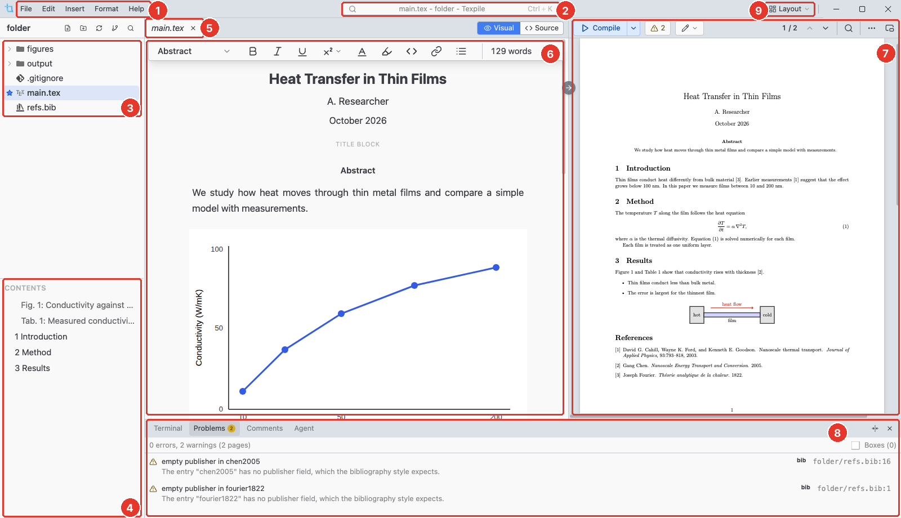

# A tour of the window

A LaTeX project, with the PDF and the bottom panel open.

1. **Menus.** On macOS they are in the system menu bar.
2. **Window title.** Click it for the [command palette](command-palette.md).
3. **Files.** The project folder. The star marks the main file.
4. **Table of Contents.**
5. **Tabs.** They work like the tabs in your browser.
6. **Editor.** Toggle between the visual and source editors.
7. **PDF Preview.**
8. **Bottom panel.** Layout › Bottom Panel shows and hides it, and Command palette › Show Terminal opens it on a terminal.
9. **Layout.** Shows and hides the sidebar, the bottom panel and the PDF, and splits the editor or the PDF.
