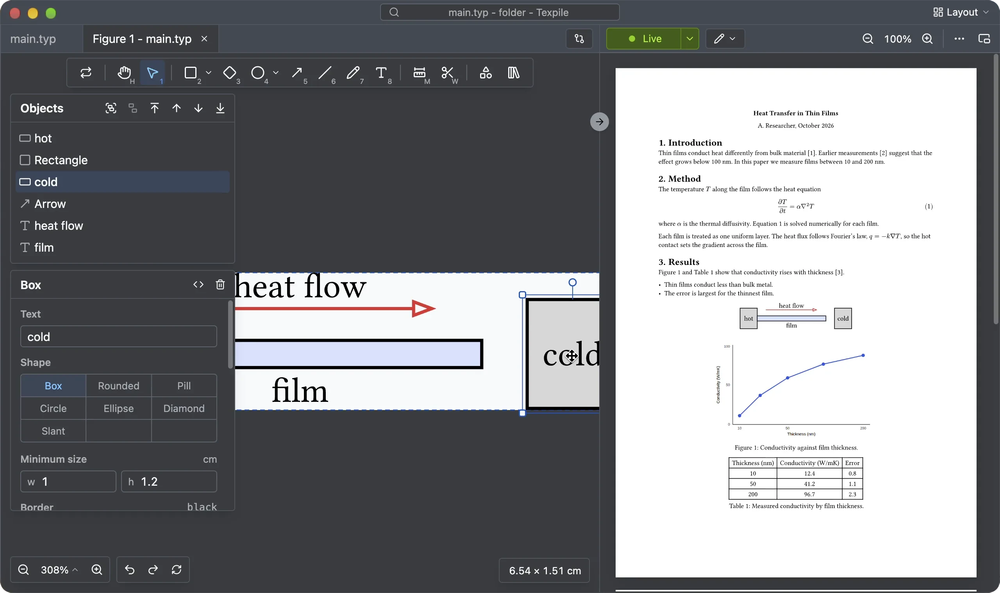

# CeTZ editor

A `#cetz.canvas` picture in a `.typ` file opens in the CeTZ editor. It works as the [TikZ editor](../latex/drawings.md) does. Every canvas edit is written into the CeTZ code in place.

> Tip: to see the CeTZ code, use the split editor, with the figure editor in one pane and the source editor in the other. Click the **Layout** button at the top right corner.

## Shortcuts

The tools have the same keys as in the [TikZ editor](../latex/drawings.md#shortcuts). The Plot and Component tools and the starting pictures are for TikZ only.

## Undo and redo

The figure shares the same undo-redo history as the original .typ file.

## tinymist

The picture on the canvas comes from tinymist, the program Texpile uses for Typst. Texpile starts it when a figure tab opens.

If tinymist is missing, the figure tab says "Typst figures need tinymist." and Texpile offers to install it. See [Install tinymist for Typst](../build-and-preview/toolchain.md#install-tinymist-for-typst).
