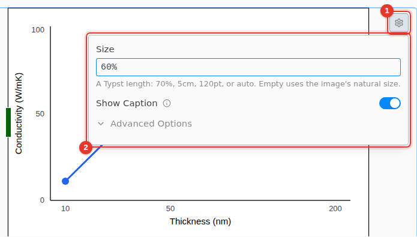

# Figures and images

Drag an image onto the editor, paste one, or use Insert › Image…. A pasted picture is saved in an `images` folder next to the file.



1. Select the image and click its settings icon.
2. Set the **Size** as a Typst length, such as `70%` or `5cm`, and turn on **Show Caption**.

The label is under **Advanced Options**. An image you give a label becomes a figure, because Typst references figures only.

## Crop and turn

Hover an image and click the crop button beside its settings button. The whole image shows with the area outside the crop box dimmed. Drag the eight handles or move the box.

The bar under the image has **Turn left**, **Turn right**, **Reset**, **Cancel** and **Done**. Enter is **Done** and Escape is **Cancel**.

**Done** wraps the image in `texpile-crop`:

```typst
texpile-crop(left: 18%, top: 8%, turn: 90deg, image("loss.png", width: 80%))
```

The first crop adds the definition of `texpile-crop` to the top of the file. The visual editor shows it as one line, "Image crop definition".

The image file stays as it is. The same file can appear twice with two different crops. Opening crop again shows the saved box.

To edit the image file itself, see [Images](../projects/images.md).
