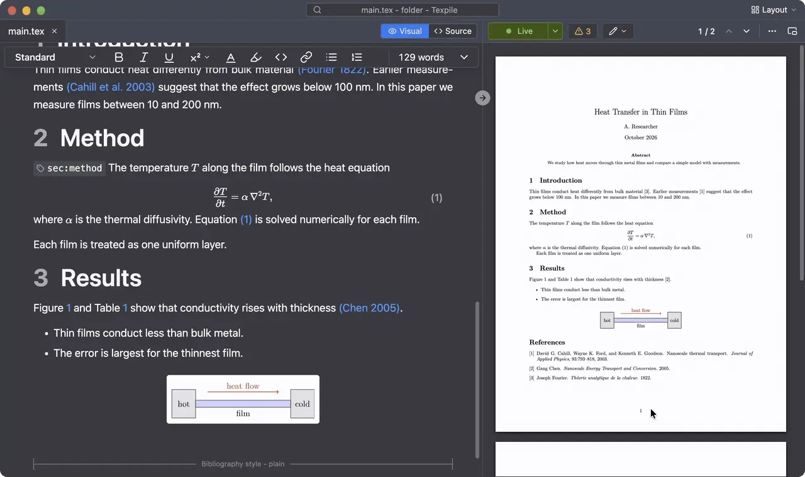
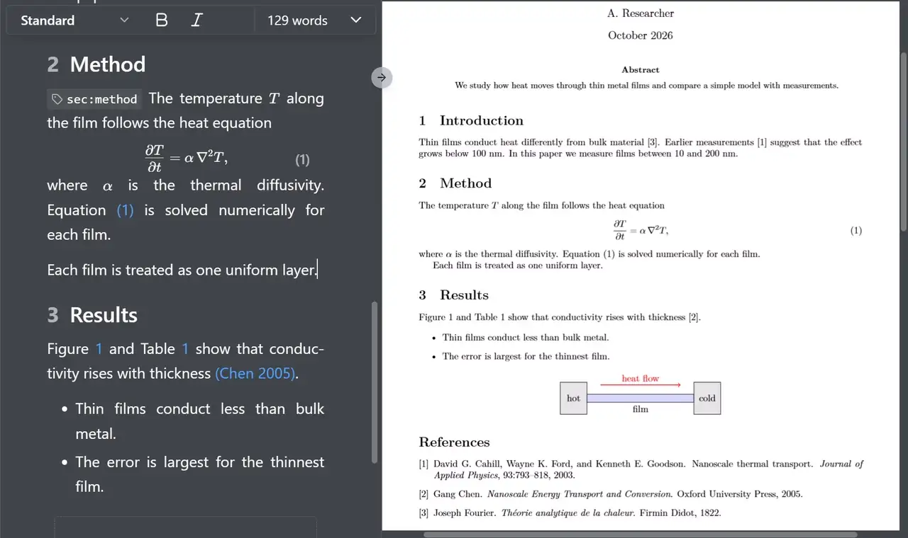
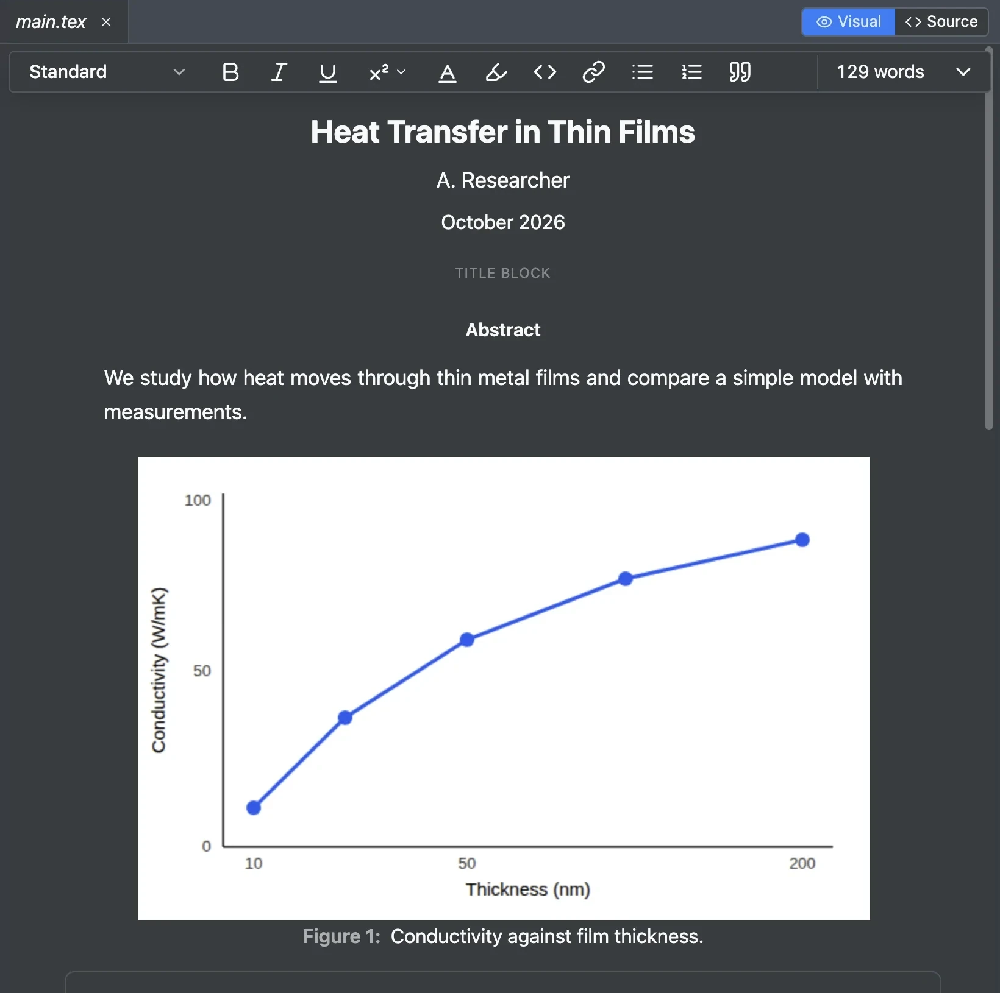
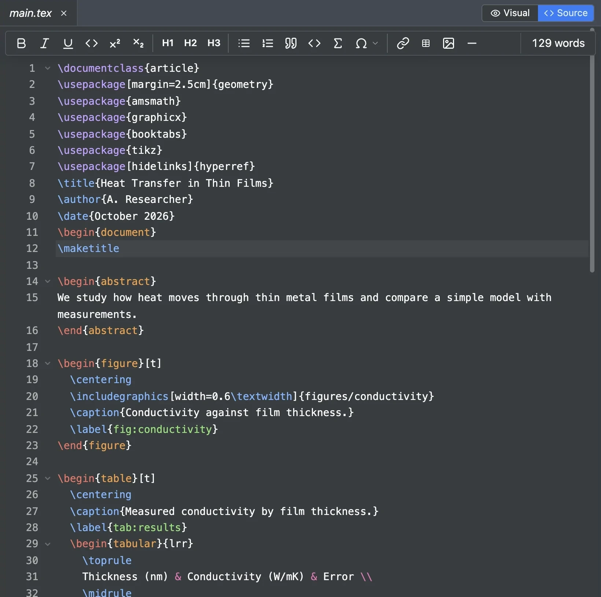
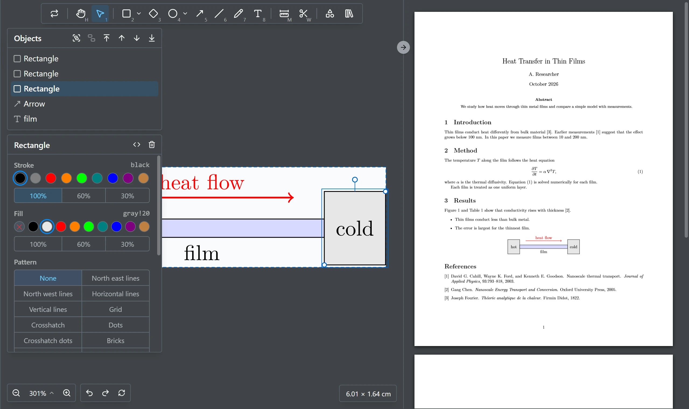

<picture>
  <source media="(prefers-color-scheme: dark)" srcset="../branding/Logo-light.svg" />
  
</picture>

&nbsp;

Ein moderner Desktop-Editor für LaTeX, Typst und Markdown. Für Windows, macOS und Linux. Bearbeiten Sie visuell oder im Quellcode mit fortgeschrittener IntelliSense. Komplett offline, ohne Konto.

[English](../README.md) | [简体中文](README.zh-Hans.md) | [繁體中文](README.zh-Hant.md) | Deutsch | [Português (Brasil)](README.pt-BR.md) | [Español](README.es.md)

---

## Warum Texpile

### Live-Vorschau

- Das PDF aktualisiert sich beim Tippen. Texpile hält Ihre LuaLaTeX-Engine am Laufen, sodass die meisten Änderungen in unter 40 ms erscheinen, ohne vollständiges Neukompilieren.
- Jedes Fenster hat seine eigene Vorschau.
- Texpile unterstützt die sofortige Live-Vorschau von Typst.

### Visueller Editor

Texpile hat die vollständigste Abdeckung der visuellen Bearbeitung für LaTeX und Typst.

- Unterstützt eigene Makros, mehrzeilige Formeln, Befehle, Tabellen mit verbundenen Zellen und Bilder.
- Unterstützt Beamer und komplexe Dokumente.
- Verwendet den Knuth-Plass-Zeilenumbruch.
- Öffnet .tex-, .typ- und .md-Dateien direkt und speichert sie in diesen Formaten.

<table>
  <tr>
    <th>Visuell</th>
    <th>Quellcode</th>
  </tr>
  <tr>
    <td></td>
    <td></td>
  </tr>
</table>

> Weitere Beispiele: https://texpile.com/#editing

### Abbildungseditor

- Eine TikZ- oder CeTZ-Abbildung öffnet sich auf einer Zeichenfläche. Texpile rendert sie mit echtem TeX und Typst, der Editor ist also WYSIWYG.

### IntelliSense

- Die LaTeX-IntelliSense-Daten von Texpile decken rund 95 % der LaTeX-Pakete auf CTAN ab (über 5.700 Pakete und 680 Klassen). Texpile macht damit sofort Vorschläge und erkennt bestimmte Fehler.
- Sie kennt das ganze Projekt: Sie liest die aux-Dateien von LaTeX und deckt Refactoring, die Erkennung eigener Makros und mehr ab.
- Für Typst nutzt Texpile tinymist für IntelliSense.

### Geteilte Sitzungen (Zusammenarbeit in Echtzeit)

Texpile unterstützt die Zusammenarbeit in Echtzeit (wie VS Code Live Share), abgestimmt auf die Arbeitsweise mit LaTeX und Typst, mit Ende-zu-Ende-Verschlüsselung. Ein Konto ist nicht nötig. Starten Sie eine Sitzung über Datei › Geteilte Sitzung.

### Kommentare und Vorschläge

Sie können in Texpile visuelle Kommentare und Änderungsvorschläge hinzufügen, wie in einer Textverarbeitung.

> [!NOTE]
> Diese Liste zeigt, was Texpile von anderen LaTeX- und Typst-Editoren unterscheidet. Alle Funktionen, einschließlich der KI-Integrationen, finden Sie auf [texpile.com](https://texpile.com).

## Installation

Laden Sie das Installationsprogramm für Ihre Plattform von [texpile.com/download](https://texpile.com/download) herunter.
Installieren Sie dann ein Satzsystem:

- [LaTeX](https://texpile.com/docs/installation/latex)
- [Typst](https://texpile.com/docs/installation/typst)

Sie können sie selbst installieren oder in Texpile mit einem Klick (siehe Dokumentation oben).

## Datenschutz

Texpile funktioniert komplett offline. Die einzigen Verbindungen zu Texpile sind die Suche nach Updates und die Zusammenarbeit in Echtzeit, die Ende-zu-Ende-verschlüsselt ist. Texpile kann Ihre Dokumente technisch nicht sehen, selbst wenn wir es wollten.

Sie können auch Ihr eigenes Relay für die Zusammenarbeit in Echtzeit betreiben.

## Community

Fragen oder Feedback? Kommen Sie auf den [Discord](https://discord.com/invite/7wanVzCBWf). Einen Fehler gefunden? [Erstellen Sie ein Issue](https://github.com/texpile/texpile/issues/new/choose).

Sicherheitsprobleme melden Sie bitte direkt per E-Mail an [support@texpile.com](mailto:support@texpile.com).

## Mitwirken

Ohne unsere Mitwirkenden und Sponsoren gäbe es Texpile nicht. Siehe [CONTRIBUTING.md](../CONTRIBUTING.md). Wenn Sie beim Übersetzen der App helfen möchten, siehe [Translation.md](../Translation.md).

## Danksagungen

Texpile baut auf anderen Open-Source-Projekten auf, siehe [ACKNOWLEDGEMENTS.md](../ACKNOWLEDGEMENTS.md).

## Lizenz

[AGPL-3.0](../LICENSE)

Der Name und das Logo von Texpile sind Marken des Texpile-Projekts und fallen nicht unter die Lizenz des Codes, siehe [TRADEMARK.md](../TRADEMARK.md).

Wir bitten außerdem darum, dass inoffizielle Builds von Texpile nicht unser Relay unter collab.texpile.com für die Zusammenarbeit in Echtzeit nutzen.
