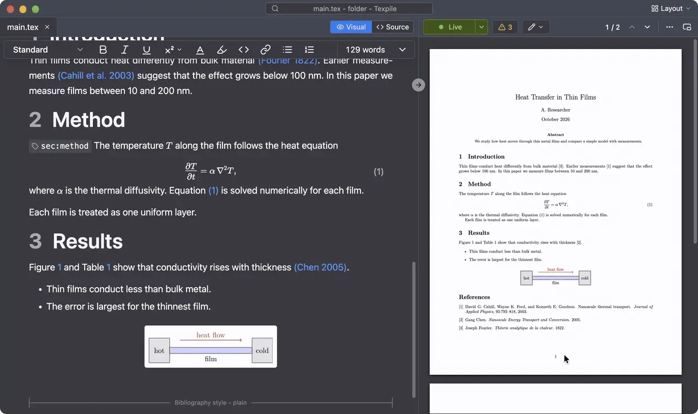
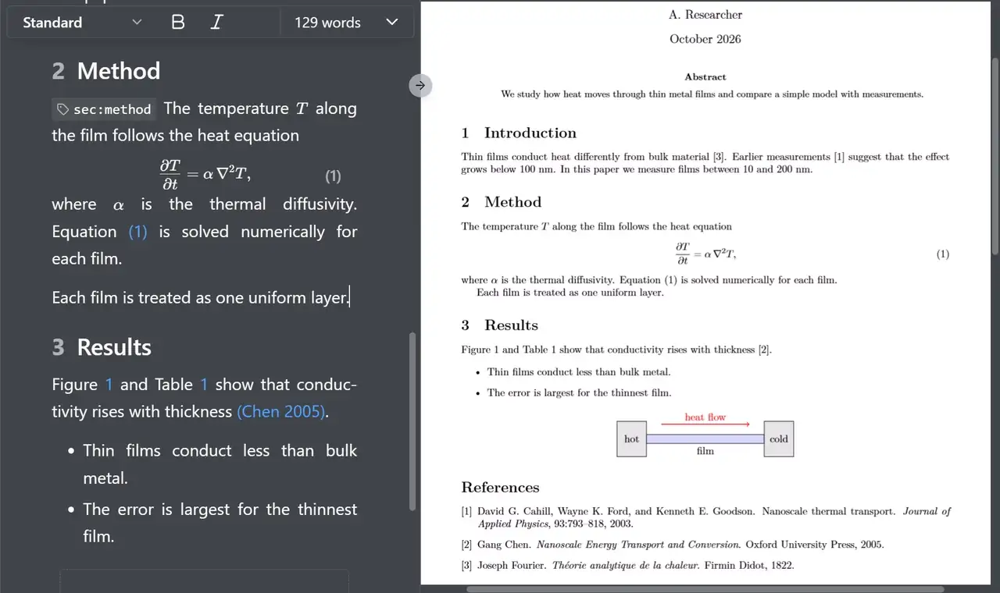
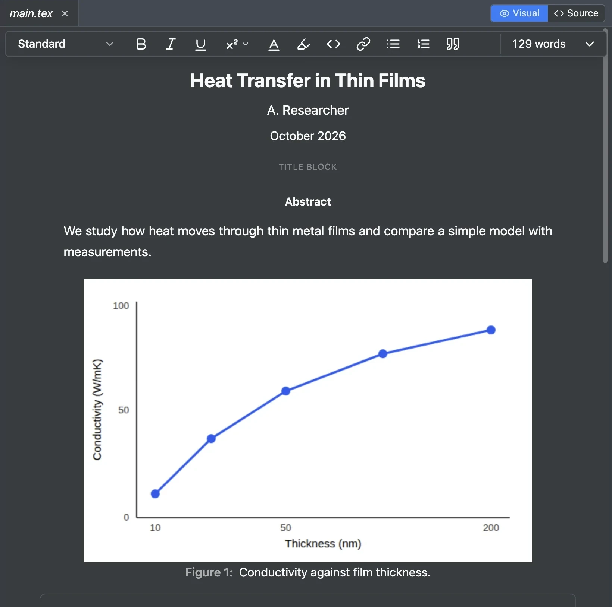
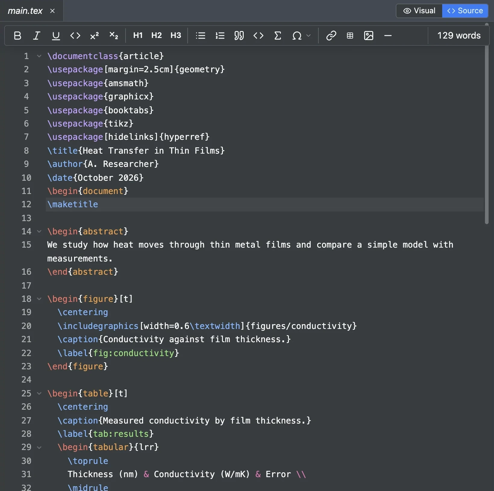
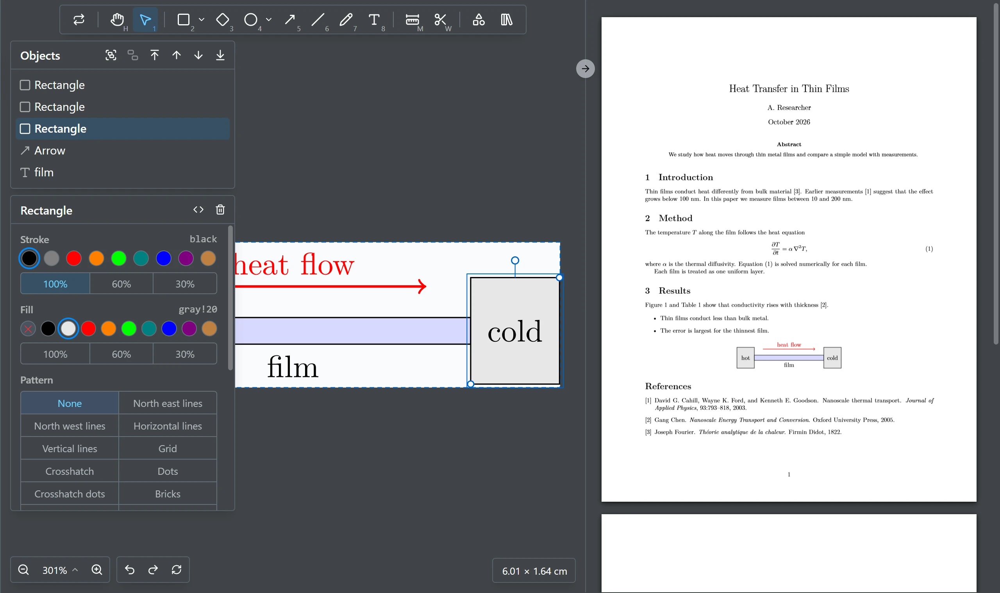

<picture>
  <source media="(prefers-color-scheme: dark)" srcset="../branding/Logo-light.svg" />
  
</picture>

&nbsp;

Un editor de escritorio moderno para LaTeX, Typst y Markdown. Para Windows, macOS y Linux. Edita de forma visual o en el código fuente con IntelliSense avanzado. 100% sin conexión, sin cuenta.

[English](../README.md) | [简体中文](README.zh-Hans.md) | [繁體中文](README.zh-Hant.md) | [Deutsch](README.de.md) | [Português (Brasil)](README.pt-BR.md) | Español

---

## Por qué Texpile

### Vista previa en tiempo real

- El PDF se actualiza mientras escribes. Texpile mantiene tu motor LuaLaTeX en marcha, así que la mayoría de los cambios aparecen en menos de 40 ms sin una recompilación completa.
- Cada ventana tiene su propia vista previa.
- Texpile es compatible con la vista previa instantánea de Typst.

### Editor visual

Texpile tiene la cobertura de edición visual más completa para LaTeX y Typst.

- Admite macros personalizadas, ecuaciones de varias líneas, comandos, tablas con celdas combinadas e imágenes.
- Admite Beamer y documentos complejos.
- Usa el algoritmo de saltos de línea de Knuth-Plass.
- Abre archivos .tex, .typ y .md directamente y los guarda en esos formatos.

<table>
  <tr>
    <th>Visual</th>
    <th>Código fuente</th>
  </tr>
  <tr>
    <td></td>
    <td></td>
  </tr>
</table>

> Puedes ver más ejemplos aquí: https://texpile.com/#editing

### Editor de figuras

- Una figura TikZ o CeTZ se abre en un lienzo. Texpile la dibuja con TeX y Typst reales, así que el editor es WYSIWYG.

### IntelliSense

- Los datos de IntelliSense de LaTeX de Texpile cubren alrededor del 95% de los paquetes de LaTeX en CTAN (más de 5.700 paquetes y 680 clases), y pueden sugerir y detectar ciertos errores al instante.
- Conoce todo el proyecto: lee los archivos aux de LaTeX y cubre la refactorización, la detección de macros personalizadas y más.
- Para Typst, Texpile usa tinymist para el IntelliSense.

### Sesiones compartidas (colaboración en tiempo real)

Texpile admite la colaboración en tiempo real (como VS Code Live Share), ajustada al trabajo con LaTeX y Typst, con cifrado de extremo a extremo. No hace falta una cuenta. Inicia una sesión desde Archivo › Sesión compartida.

### Comentarios y sugerencias

Puedes añadir comentarios y sugerencias visuales en Texpile, como en un procesador de textos.

> [!NOTE]
> Esta lista muestra lo que distingue a Texpile de otros editores de LaTeX y Typst. Consulta todas las funciones, incluidas las integraciones con IA, en [texpile.com](https://texpile.com).

## Instalación

Descarga el instalador para tu plataforma desde [texpile.com/download](https://texpile.com/download).
Después instala un sistema de composición:

- [LaTeX](https://texpile.com/docs/installation/latex)
- [Typst](https://texpile.com/docs/installation/typst)

Puedes instalarlos por tu cuenta o con un clic desde Texpile (consulta la documentación de arriba).

## Privacidad

Texpile funciona totalmente sin conexión. Sus únicas conexiones con Texpile son la búsqueda de actualizaciones y la colaboración en tiempo real, que está cifrada de extremo a extremo. Texpile no tiene forma de ver tus documentos, aunque quisiéramos.

También puedes alojar tu propio relay de colaboración en tiempo real.

## Comunidad

¿Preguntas o comentarios? Únete al [Discord](https://discord.com/invite/7wanVzCBWf). ¿Encontraste un error? [Abre una issue](https://github.com/texpile/texpile/issues/new/choose).

Para problemas de seguridad, escribe directamente a [support@texpile.com](mailto:support@texpile.com).

## Contribuir

Texpile no sería posible sin nuestros colaboradores y patrocinadores. Consulta [CONTRIBUTING.md](../CONTRIBUTING.md). Para ayudar a traducir la aplicación, consulta [Translation.md](../Translation.md).

## Agradecimientos

Texpile se basa en otros proyectos de código abierto; consulta [ACKNOWLEDGEMENTS.md](../ACKNOWLEDGEMENTS.md).

## Licencia

[AGPL-3.0](../LICENSE)

El nombre y el logotipo de Texpile son marcas del proyecto Texpile y no están cubiertos por la licencia del código; consulta [TRADEMARK.md](../TRADEMARK.md).

También pedimos que las compilaciones no oficiales de Texpile no usen nuestro relay alojado en collab.texpile.com para la colaboración en tiempo real.
