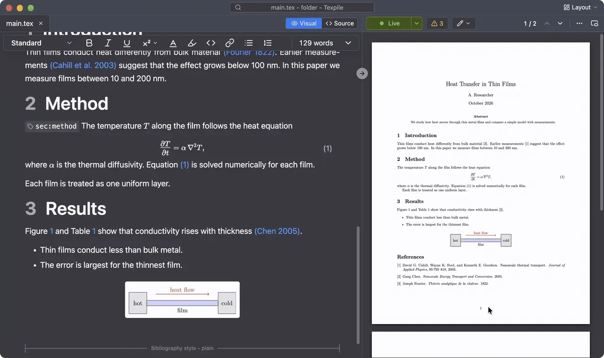
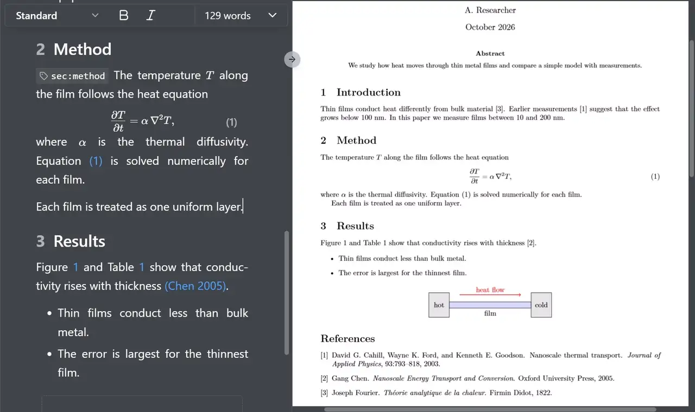
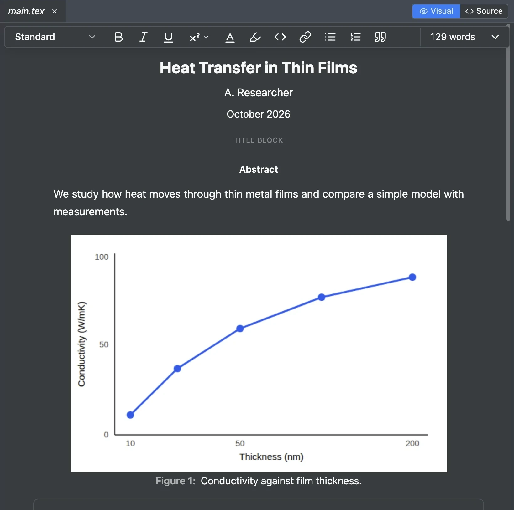
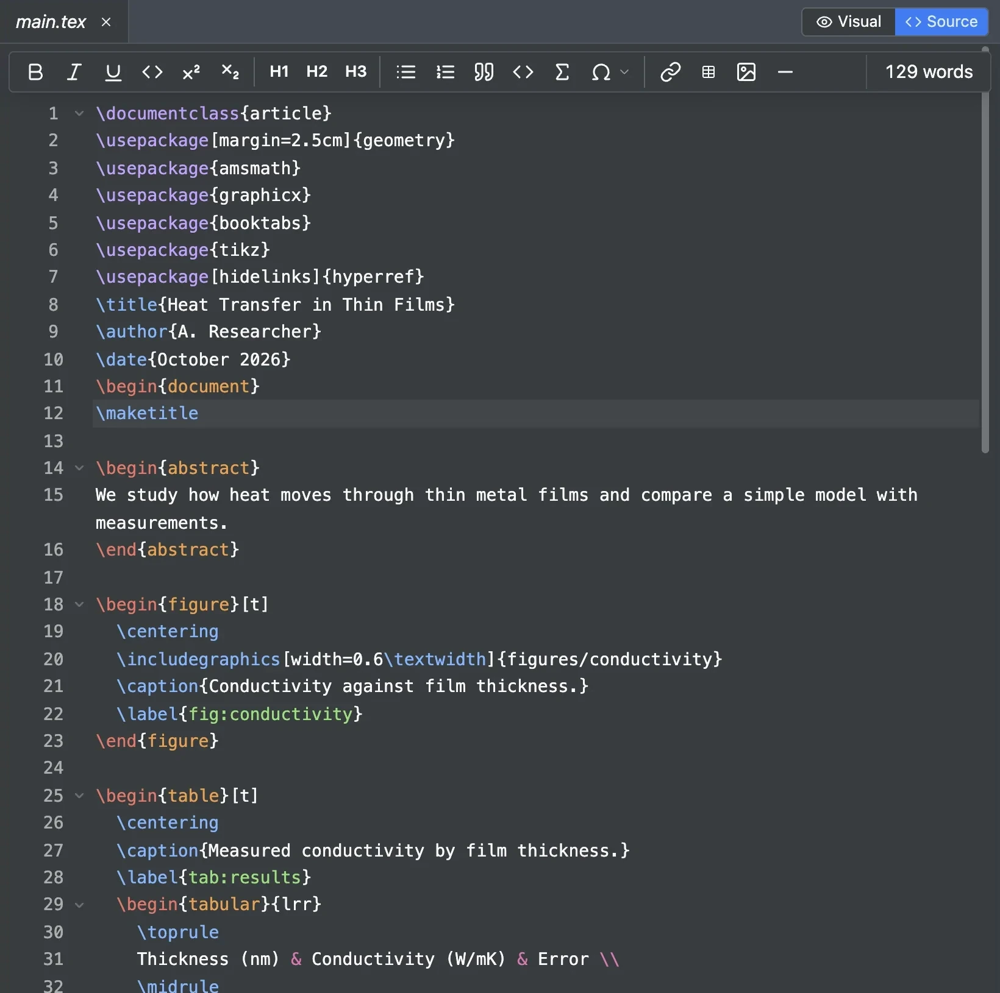
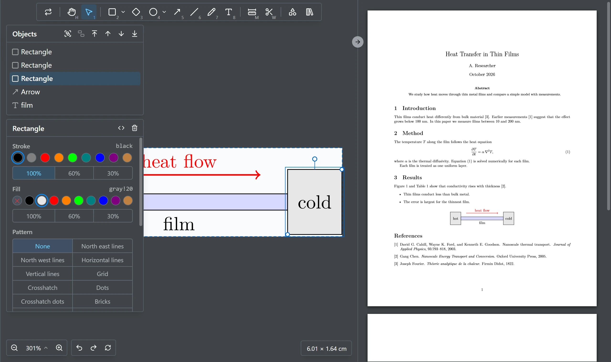

<picture>
  <source media="(prefers-color-scheme: dark)" srcset="../branding/Logo-light.svg" />
  
</picture>

&nbsp;

Um editor moderno para desktop para LaTeX, Typst e Markdown. Para Windows, macOS e Linux. Edite visualmente ou no código-fonte com IntelliSense avançado. 100% offline, sem conta.

[English](../README.md) | [简体中文](README.zh-Hans.md) | [繁體中文](README.zh-Hant.md) | [Deutsch](README.de.md) | Português (Brasil) | [Español](README.es.md)

---

## Por que o Texpile

### Visualização ao vivo

- O PDF é atualizado enquanto você digita. O Texpile mantém seu motor LuaLaTeX em execução, então a maioria das edições aparece em menos de 40 ms, sem uma recompilação completa.
- Cada janela tem sua própria visualização.
- O Texpile suporta a visualização ao vivo instantânea do Typst.

### Editor visual

O Texpile tem a cobertura de edição visual mais completa para LaTeX e Typst.

- Suporta macros personalizadas, equações de várias linhas, comandos, tabelas com células mescladas e imagens.
- Suporta Beamer e documentos complexos.
- Usa a quebra de linha de Knuth-Plass.
- Abre arquivos .tex, .typ e .md diretamente e os salva nesses formatos.

<table>
  <tr>
    <th>Visual</th>
    <th>Código-fonte</th>
  </tr>
  <tr>
    <td></td>
    <td></td>
  </tr>
</table>

> Veja mais exemplos aqui: https://texpile.com/#editing

### Editor de figuras

- Uma figura TikZ ou CeTZ abre em uma tela de desenho. O Texpile a renderiza com TeX e Typst de verdade, então o editor é WYSIWYG.

### IntelliSense

- Os dados de IntelliSense de LaTeX do Texpile cobrem cerca de 95% dos pacotes LaTeX do CTAN (mais de 5.700 pacotes e 680 classes) e podem sugerir e detectar certos erros na hora.
- Ele conhece o projeto inteiro: lê os arquivos aux do LaTeX e cobre refatoração, detecção de macros personalizadas e mais.
- Para Typst, o Texpile usa o tinymist para o IntelliSense.

### Sessões compartilhadas (colaboração em tempo real)

O Texpile suporta colaboração em tempo real (como o VS Code Live Share), ajustada para o trabalho com LaTeX e Typst, com criptografia de ponta a ponta. Não é preciso ter conta. Inicie uma sessão em Arquivo › Sessão compartilhada.

### Comentários e sugestões

Você pode adicionar comentários e sugestões visuais no Texpile, como em um processador de texto.

> [!NOTE]
> Esta lista mostra o que diferencia o Texpile de outros editores de LaTeX e Typst. Veja todos os recursos, incluindo as integrações com IA, em [texpile.com](https://texpile.com).

## Instalação

Baixe o instalador para sua plataforma em [texpile.com/download](https://texpile.com/download).
Depois instale um sistema de composição:

- [LaTeX](https://texpile.com/docs/installation/latex)
- [Typst](https://texpile.com/docs/installation/typst)

Você pode instalá-los por conta própria ou com um clique no Texpile (veja a documentação acima).

## Privacidade

O Texpile funciona totalmente offline. Suas únicas conexões com o Texpile são a verificação de atualizações e a colaboração em tempo real, que tem criptografia de ponta a ponta. O Texpile não tem como ver seus documentos, mesmo que quiséssemos.

Você também pode hospedar seu próprio relay de colaboração em tempo real.

## Comunidade

Dúvidas ou sugestões? Entre no [Discord](https://discord.com/invite/7wanVzCBWf). Encontrou um bug? [Abra uma issue](https://github.com/texpile/texpile/issues/new/choose).

Para problemas de segurança, envie um e-mail diretamente para [support@texpile.com](mailto:support@texpile.com).

## Contribuindo

O Texpile não seria possível sem nossos colaboradores e patrocinadores. Veja [CONTRIBUTING.md](../CONTRIBUTING.md). Para ajudar a traduzir o aplicativo, veja [Translation.md](../Translation.md).

## Agradecimentos

O Texpile se baseia em outros projetos de código aberto; veja [ACKNOWLEDGEMENTS.md](../ACKNOWLEDGEMENTS.md).

## Licença

[AGPL-3.0](../LICENSE)

O nome e o logotipo do Texpile são marcas do projeto Texpile e não são cobertos pela licença do código; veja [TRADEMARK.md](../TRADEMARK.md).

Também pedimos que builds não oficiais do Texpile não usem nosso relay hospedado em collab.texpile.com para colaboração em tempo real.
