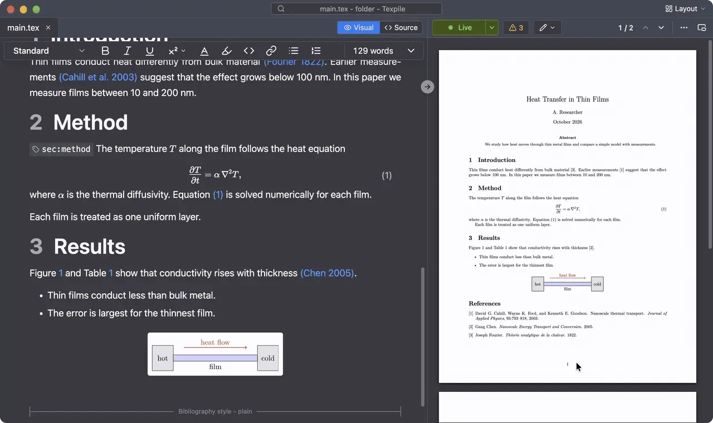
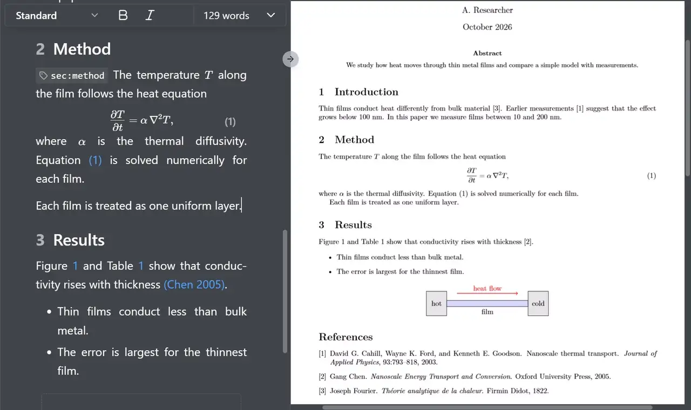
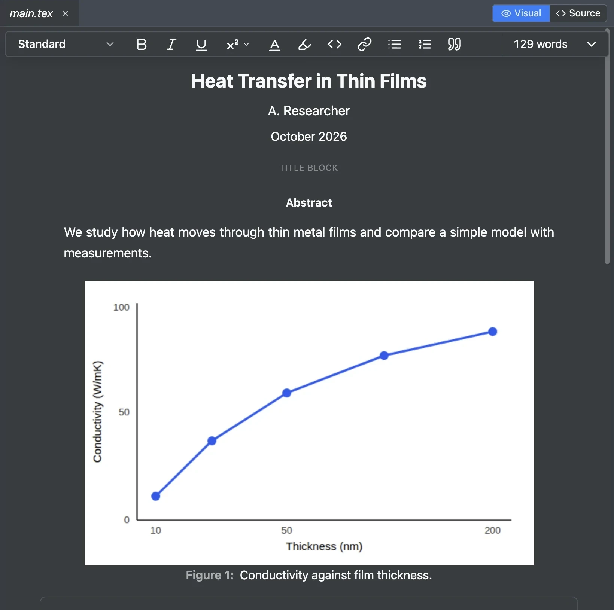
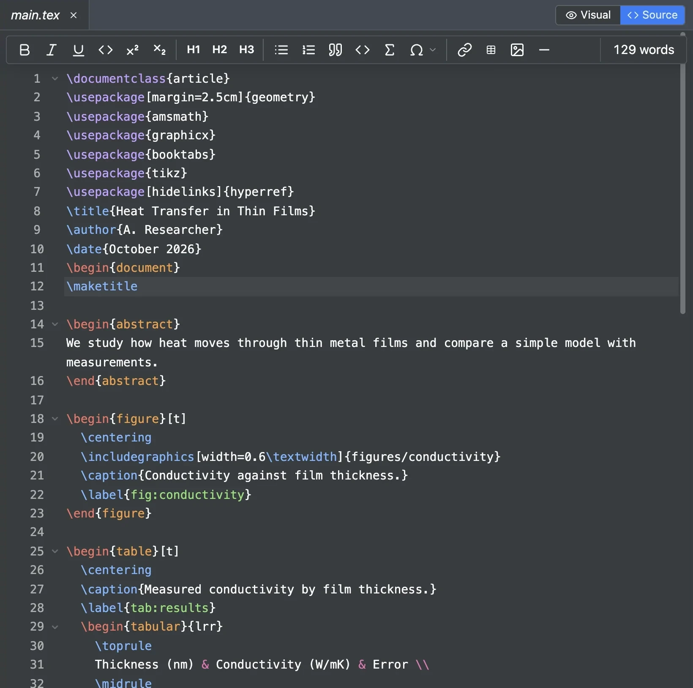
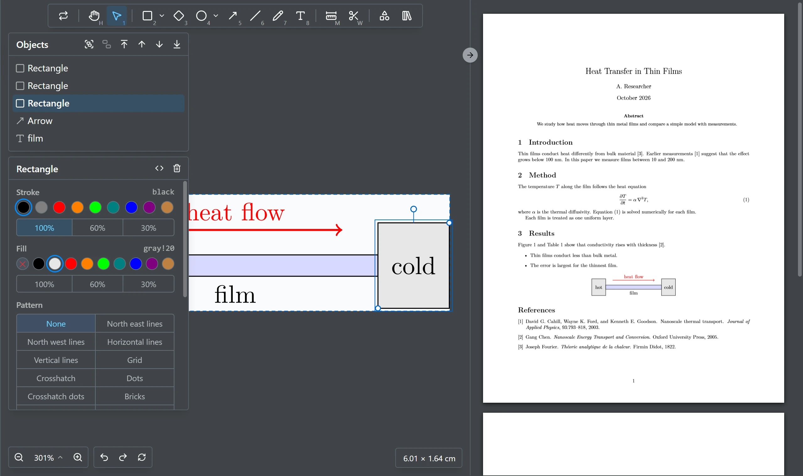

<picture>
  <source media="(prefers-color-scheme: dark)" srcset="../branding/Logo-light.svg" />
  
</picture>

&nbsp;

一款现代的桌面编辑器，支持 LaTeX、Typst 和 Markdown，适用于 Windows、macOS 和 Linux。可以可视化编辑，也可以在带高级智能提示的源码里编辑。完全离线，无需账号。

[English](../README.md) | 简体中文 | [繁體中文](README.zh-Hant.md) | [Deutsch](README.de.md) | [Português (Brasil)](README.pt-BR.md) | [Español](README.es.md)

---

## 为什么选择 Texpile

### 实时预览

- PDF 随输入更新。Texpile 让你的 LuaLaTeX 引擎保持运行，大多数修改不到 40 毫秒就能显示，无需完整重新编译。
- 每个窗口都有自己的预览。
- Texpile 支持 Typst 的即时实时预览。

### 可视化编辑器

Texpile 对 LaTeX 和 Typst 的可视化编辑覆盖最为完整。

- 支持自定义宏、多行公式、命令、可合并单元格的表格和图片。
- 支持 Beamer 和复杂文档。
- 使用 Knuth-Plass 断行算法。
- 直接打开 .tex、.typ 和 .md 文件，并以原格式保存。

<table>
  <tr>
    <th>可视化</th>
    <th>源码</th>
  </tr>
  <tr>
    <td></td>
    <td></td>
  </tr>
</table>

> 更多示例：https://texpile.com/zh-Hans/#editing

### 绘图编辑器

- TikZ 或 CeTZ 图形会在画布上打开。Texpile 用真正的 TeX 和 Typst 渲染，所见即所得。

### 智能提示

- Texpile 的 LaTeX 智能提示数据覆盖 CTAN 上约 95% 的 LaTeX 宏包（超过 5,700 个宏包和 680 个文档类），能即时给出建议并发现部分错误。
- 它能理解整个项目：解析 LaTeX 的 aux 文件，支持重构、自定义宏识别等功能。
- Typst 的智能提示由 tinymist 提供。

### 共享协作（实时协作）

Texpile 支持实时协作（类似 VS Code Live Share），专门为 LaTeX 和 Typst 的工作流程调整，并采用端到端加密。无需账号。在 文件 › 共享协作 中开始一次协作。

### 批注与修改建议

你可以像在文字处理软件里一样，在 Texpile 中添加可视化的批注和修改建议。

> [!NOTE]
> 这里列出的是 Texpile 与其他 LaTeX 和 Typst 编辑器的不同之处。全部功能（包括 AI 集成）请见 [texpile.com](https://texpile.com/zh-Hans)。

## 安装

从 [texpile.com/download](https://texpile.com/zh-Hans/download) 下载适合你平台的安装程序。
然后安装一个排版引擎：

- [LaTeX](https://texpile.com/zh-Hans/docs/installation/latex)
- [Typst](https://texpile.com/zh-Hans/docs/installation/typst)

你可以自己安装，也可以在 Texpile 里一键安装（见上面的文档）。

## 隐私

Texpile 完全离线工作。它与 Texpile 服务器的连接只有更新检查和实时协作，而实时协作是端到端加密的。即使我们想看，Texpile 在技术上也无法看到你的文档。

你也可以自建实时协作中继服务器。

## 社区

有问题或反馈？加入 [Discord](https://discord.com/invite/7wanVzCBWf)。发现了 bug？[提交 issue](https://github.com/texpile/texpile/issues/new/choose)。

安全问题请直接发邮件至 [support@texpile.com](mailto:support@texpile.com)。

## 参与贡献

没有贡献者和赞助者就没有 Texpile。请见 [CONTRIBUTING.md](../CONTRIBUTING.md)。想帮忙翻译这个应用，请见 [Translation.md](../Translation.md)。

## 致谢

Texpile 建立在其他开源项目之上，见 [ACKNOWLEDGEMENTS.md](../ACKNOWLEDGEMENTS.md)。

## 许可证

[AGPL-3.0](../LICENSE)

Texpile 的名称和标志是 Texpile 项目的商标，不在代码许可证的范围内，见 [TRADEMARK.md](../TRADEMARK.md)。

我们也请非官方构建的 Texpile 不要使用我们托管在 collab.texpile.com 的中继服务器进行实时协作。
