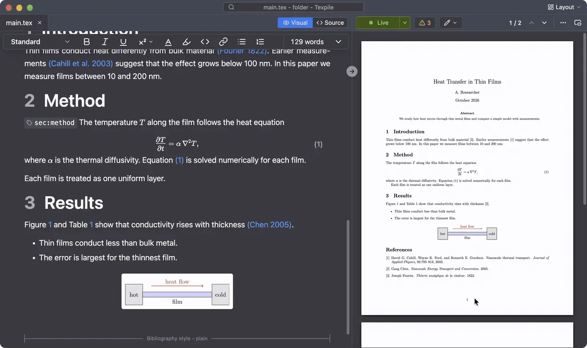
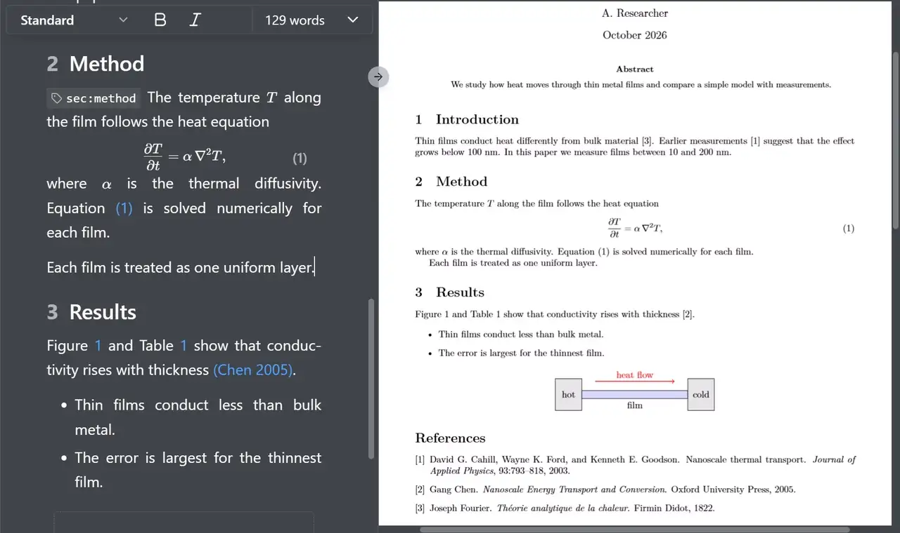
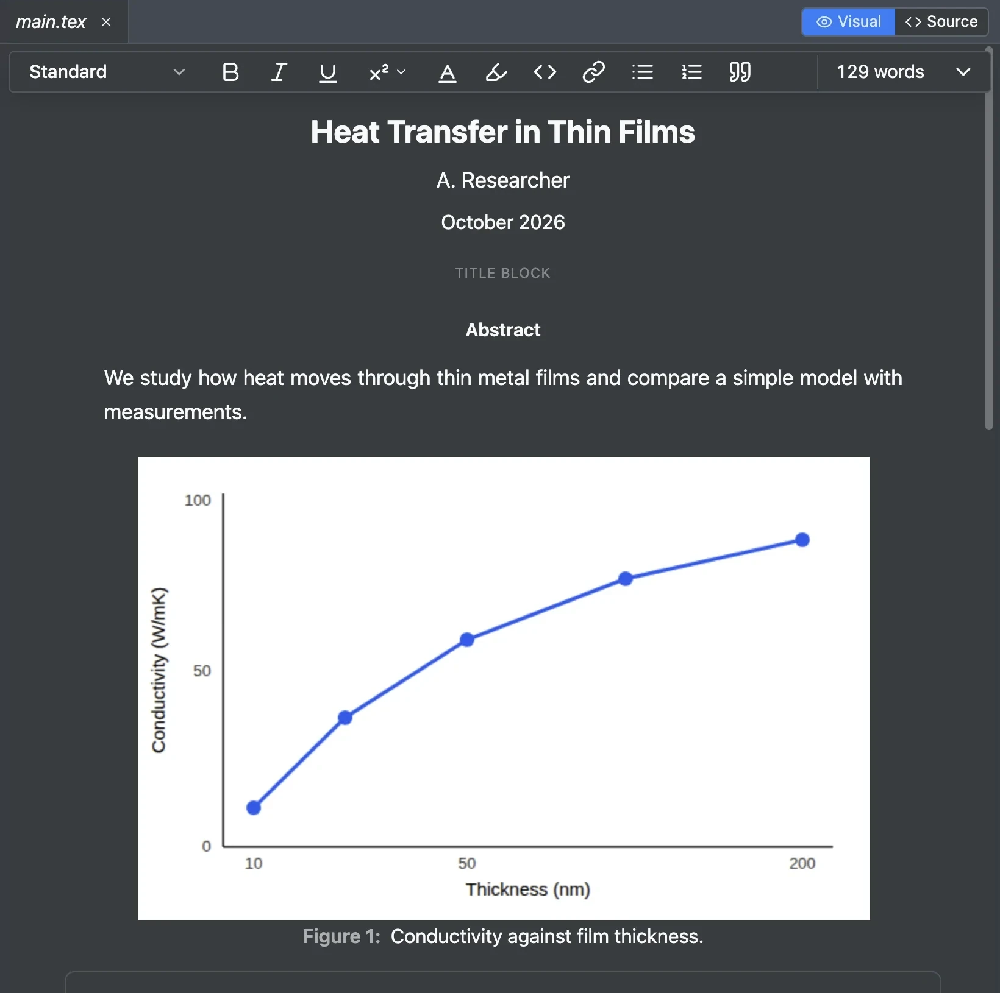
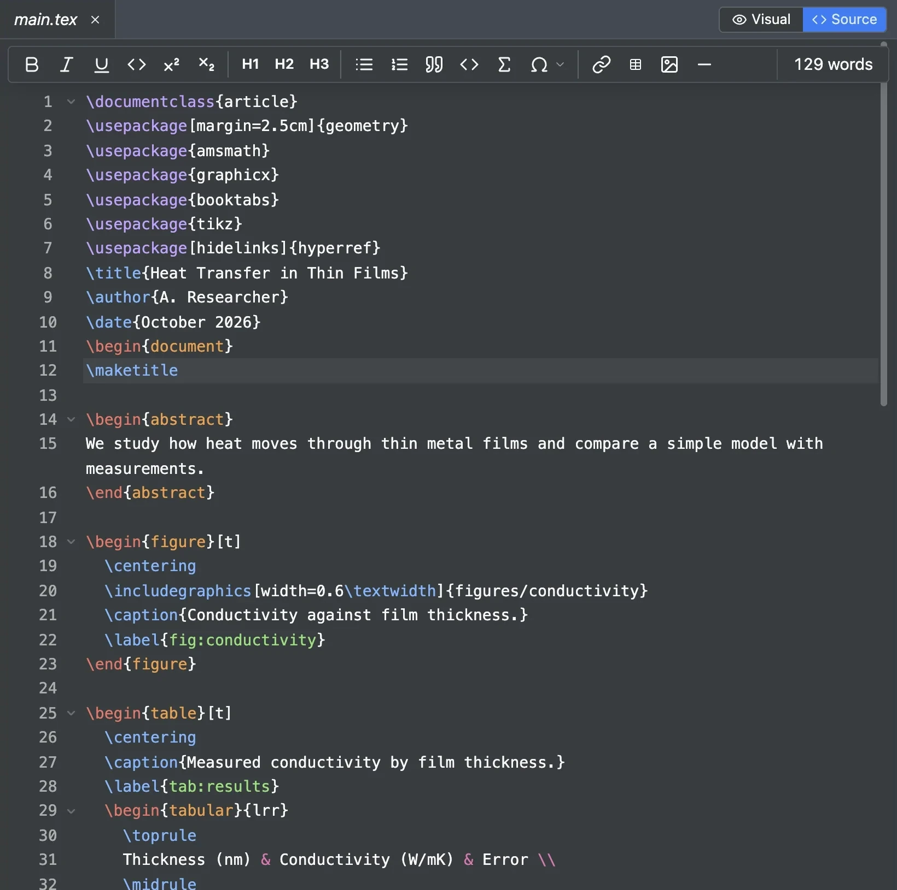
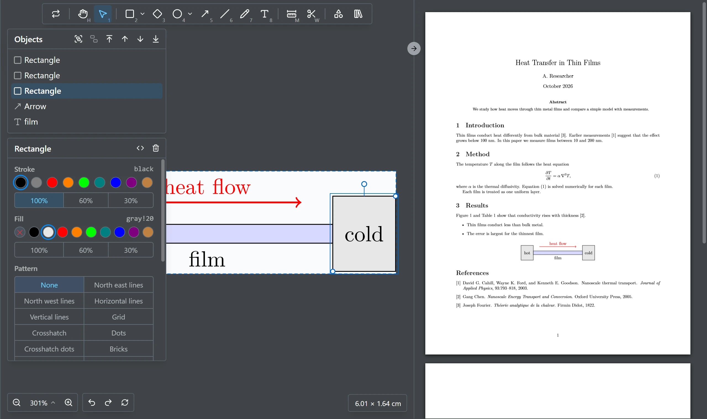

<picture>
  <source media="(prefers-color-scheme: dark)" srcset="../branding/Logo-light.svg" />
  
</picture>

&nbsp;

一款現代的桌面編輯器，支援 LaTeX、Typst 與 Markdown，適用於 Windows、macOS 與 Linux。可以視覺化編輯，也可以在具備進階智慧提示的原始碼中編輯。完全離線，不需要帳號。

[English](../README.md) | [简体中文](README.zh-Hans.md) | 繁體中文 | [Deutsch](README.de.md) | [Português (Brasil)](README.pt-BR.md) | [Español](README.es.md)

---

## 為什麼選擇 Texpile

### 即時預覽

- PDF 隨著輸入更新。Texpile 讓你的 LuaLaTeX 引擎持續執行，大多數修改不到 40 毫秒就會顯示，不需要完整重新編譯。
- 每個視窗都有自己的預覽。
- Texpile 支援 Typst 的即時預覽。

### 視覺化編輯器

Texpile 對 LaTeX 與 Typst 的視覺化編輯涵蓋範圍最完整。

- 支援自訂巨集、多行數學式、指令、可合併儲存格的表格與圖片。
- 支援 Beamer 與複雜的文件。
- 使用 Knuth-Plass 斷行演算法。
- 直接開啟 .tex、.typ 與 .md 檔案，並以原本的格式儲存。

<table>
  <tr>
    <th>視覺化</th>
    <th>原始碼</th>
  </tr>
  <tr>
    <td></td>
    <td></td>
  </tr>
</table>

> 更多範例：https://texpile.com/zh-Hant/#editing

### 繪圖編輯器

- TikZ 或 CeTZ 圖形會在畫布上開啟。Texpile 用真正的 TeX 與 Typst 繪製，所見即所得。

### 智慧提示

- Texpile 的 LaTeX 智慧提示資料涵蓋 CTAN 上約 95% 的 LaTeX 套件（超過 5,700 個套件與 680 個文件類別），能即時提供建議並發現部分錯誤。
- 它能理解整個專案：解析 LaTeX 的 aux 檔案，支援重構、自訂巨集辨識等功能。
- Typst 的智慧提示由 tinymist 提供。

### 共享協作（即時協作）

Texpile 支援即時協作（類似 VS Code Live Share），專為 LaTeX 與 Typst 的工作流程調整，並採用端對端加密。不需要帳號。在 檔案 › 共享協作 中開始一次協作。

### 註解與修改建議

你可以像在文書處理軟體中一樣，在 Texpile 裡加入視覺化的註解與修改建議。

> [!NOTE]
> 這裡列出的是 Texpile 與其他 LaTeX 與 Typst 編輯器的不同之處。所有功能（包括 AI 整合）請見 [texpile.com](https://texpile.com/zh-Hant)。

## 安裝

從 [texpile.com/download](https://texpile.com/zh-Hant/download) 下載適合你平台的安裝程式。
接著安裝一個排版引擎：

- [LaTeX](https://texpile.com/zh-Hant/docs/installation/latex)
- [Typst](https://texpile.com/zh-Hant/docs/installation/typst)

你可以自行安裝，也可以在 Texpile 中一鍵安裝（見上方文件）。

## 隱私

Texpile 完全離線運作。它與 Texpile 伺服器的連線只有更新檢查與即時協作，而即時協作採用端對端加密。即使我們想看，Texpile 在技術上也無法看到你的文件。

你也可以自行架設即時協作的中繼伺服器。

## 社群

有問題或意見？加入 [Discord](https://discord.com/invite/7wanVzCBWf)。發現 bug？[提交 issue](https://github.com/texpile/texpile/issues/new/choose)。

安全性問題請直接寄信至 [support@texpile.com](mailto:support@texpile.com)。

## 參與貢獻

沒有貢獻者與贊助者就沒有 Texpile。請見 [CONTRIBUTING.md](../CONTRIBUTING.md)。想協助翻譯這個應用程式，請見 [Translation.md](../Translation.md)。

## 致謝

Texpile 建立在其他開源專案之上，見 [ACKNOWLEDGEMENTS.md](../ACKNOWLEDGEMENTS.md)。

## 授權

[AGPL-3.0](../LICENSE)

Texpile 的名稱與標誌是 Texpile 專案的商標，不在程式碼授權的範圍內，見 [TRADEMARK.md](../TRADEMARK.md)。

我們也請非官方建置的 Texpile 不要使用我們架設在 collab.texpile.com 的中繼伺服器進行即時協作。
